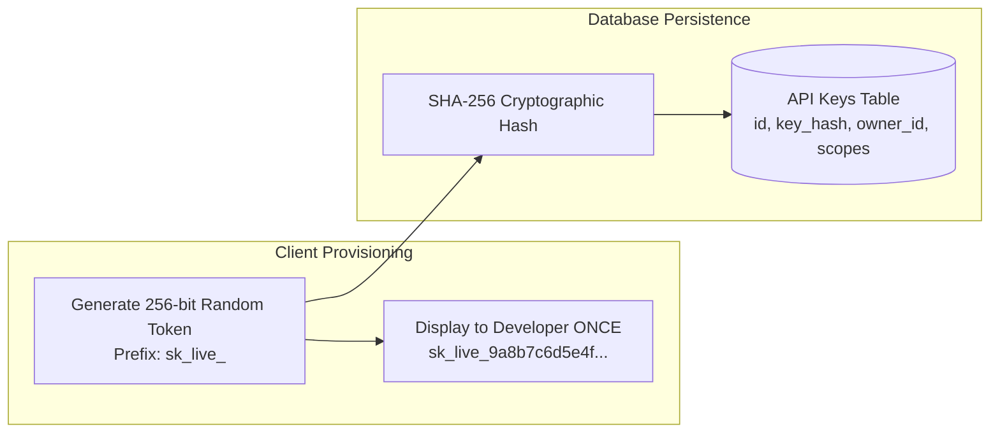
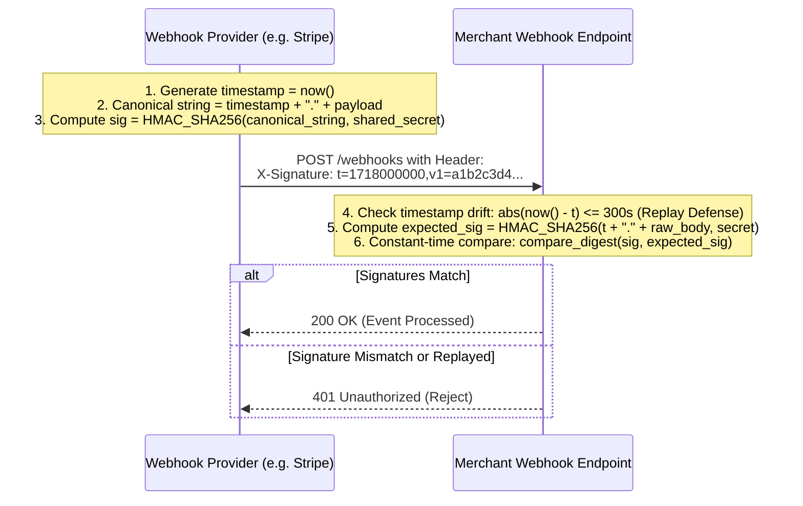
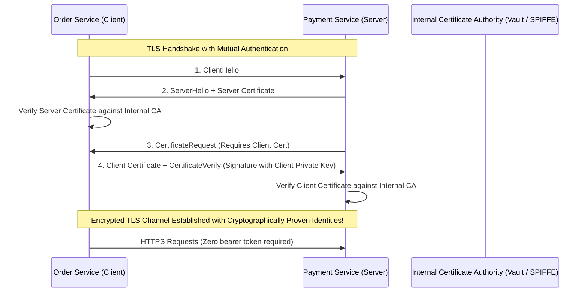

# API Keys, HMAC Signatures & Mutual TLS (mTLS)

When securing B2B integrations, third-party developer platforms, public webhooks, and internal zero-trust service meshes, traditional browser cookies and user JWTs do not apply.

---

## 1. Enterprise API Key Design & Storage

An API Key must be treated with the same security rigor as a user password. **Never store plaintext API keys in your database.**



### 1. Prefixes & Secret Scanner Detection
Format keys with identifiable prefixes:
- Secret keys: `sk_live_...` / `sk_test_...`
- Publishable keys: `pk_live_...`
- **Why**: Allows automated security scanners (GitHub Secret Scanning, TruffleHog, GitGuardian) to flag accidentally committed keys instantly.

### 2. Fast Key Verification Workflow
1. Client transmits header: `Authorization: Bearer sk_live_abc123...`
2. Server extracts token and computes `hash = SHA256("sk_live_abc123...")`.
3. Server queries database or Redis cache by `key_hash`:
   `SELECT * FROM api_keys WHERE key_hash = :hash AND is_revoked = false;`
4. If the database is compromised, the attacker only obtains one-way SHA-256 hashes and **cannot forge API calls**.

---

## 2. HMAC Request Signatures (Webhooks & Financial APIs)

When delivering webhooks (e.g. Stripe, GitHub, Shopify) or processing financial transactions, an API key is insufficient because:
1. It does not verify that the request payload was not tampered with in transit.
2. It does not protect against **Replay Attacks** (an attacker capturing a valid HTTP request and re-submitting it 100 times).



### Python HMAC Verification Example:
```python
import hmac
import hashlib
import time

def verify_webhook_signature(
    raw_payload_bytes: bytes, 
    signature_header: str, 
    shared_secret: str,
    max_tolerance_seconds: int = 300
) -> bool:
    """
    Verifies payload authenticity and prevents replay attacks.
    Constant-time comparison protects against timing attacks.
    """
    # Parse header: "t=1718000000,v1=5257a869e7..."
    parts = dict(item.split("=") for item in signature_header.split(","))
    timestamp = int(parts.get("t", 0))
    received_signature = parts.get("v1", "")

    # 1. Replay Attack Defense (Timestamp Drift)
    if abs(time.time() - timestamp) > max_tolerance_seconds:
        return False

    # 2. Canonical Payload Construction
    canonical_payload = f"{timestamp}.".encode("utf-8") + raw_payload_bytes

    # 3. Compute Expected Signature
    expected_signature = hmac.new(
        shared_secret.encode("utf-8"),
        canonical_payload,
        hashlib.sha256
    ).hexdigest()

    # 4. Constant-Time Comparison (Timing Attack Defense)
    return hmac.compare_digest(expected_signature, received_signature)
```

---

## 3. Mutual TLS (mTLS) for Zero-Trust Microservices

In traditional TLS, the server presents a certificate to prove its identity to the client. In **Mutual TLS (mTLS)**, the client also presents an **X.509 client certificate** during the TLS handshake.



### Advantages of mTLS:
1. **Zero Credential Exfiltration**: There are no API keys, tokens, or passwords to leak in HTTP headers or application logs.
2. **Transport-Layer Identity**: Identity is cryptographically established before application code (HTTP route handlers) executes.
3. **Defense Against MITM**: Even if DNS is spoofed, connection fails because certificates do not match the internal CA root.

