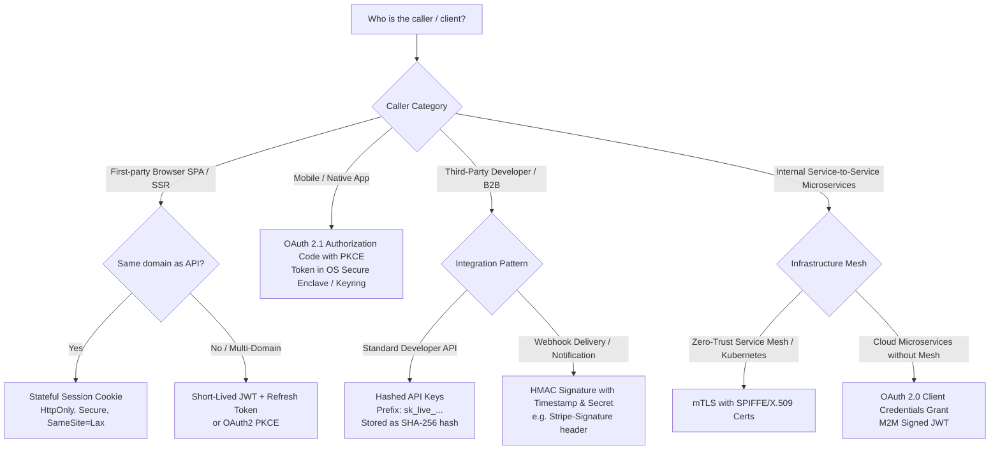
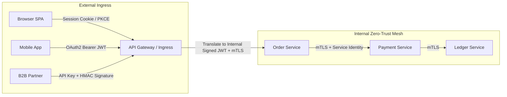

# API Authentication Strategies: Architectural Decision Matrix

Selecting an authentication mechanism is a foundational architectural decision that dictates scalability, latency, client complexity, and security posture. There is no single "best" authentication mechanism; the correct choice depends on client trust, network boundaries, and revocation requirements.

---

## 1. High-Level Comparison Matrix

| Strategy | Client Type | State / Storage | Revocation Speed | Latency Overhead | Key Strength | Primary Risk / Trade-Off |
|---|---|---|---|---|---|---|
| **Stateless JWT (Bearer)** | Mobile apps, SPAs, cross-domain microservices | Stateless (Self-contained signature) | Difficult (Requires Redis blacklist or token version epoch) | Zero DB/Cache lookup on verify (< 0.1 ms) | Scalable horizontally across thousands of services without database bottleneck. | Token cannot be revoked instantly without central state; payload size overhead (~500B–2KB per request). |
| **OAuth 2.0 / OIDC** | Third-party integrations, enterprise SSO, mobile/SPA delegation | Centralized Identity Provider (Auth0, Okta, Keycloak) | Fast via IdP / Introspection | Low with cached JWKS; high if full introspection per request | Delegated authorization, standard federation, granular scopes. | High implementation complexity; requires managing grants, redirects, and JWKS key rotation. |
| **Stateful Session Token** | First-party web apps, SSR frontends (Next.js, Django, Rails) | Stateful (Session ID in DB or Redis) | **Instant** (Delete key from Redis/DB) | 0.5–2.0 ms (Redis/DB lookup per request) | Instant revocation, simple client management, protected from XSS via `HttpOnly`. | Sensitive to CSRF; requires central session store (Redis) to scale horizontally. |
| **API Keys** | Server-to-server B2B integrations, developer APIs (Stripe, GitHub) | Hashed key in database/cache | Instant (Set key status = `revoked`) | 0.5–1.0 ms (Lookup hashed key in cache/DB) | Simple client developer experience (header `Authorization: Bearer sk_...`); easily scoped and metered. | Susceptible to leakage if logged or hardcoded; client cannot safely store secret on frontend. |
| **mTLS (Mutual TLS)** | Internal service-to-service, zero-trust microservice meshes | Cryptographic (X.509 certificates verified in TLS handshake) | Fast via CRL / OCSP stapling | Zero application layer overhead (handled at TLS termination) | Cryptographic identity verification at transport layer; completely immune to token replay and phishing. | Complex PKI / certificate lifecycle management (issuance, rotation, expiration). |
| **HMAC Request Signatures** | Webhooks, high-security B2B financial APIs (AWS SigV4, Stripe) | Shared secret + cryptographic signature over payload | Instant (Revoke shared secret) | < 0.1 ms (Local HMAC calculation in memory) | Guarantees payload integrity and non-repudiation; immune to replay attacks via timestamp and nonce. | Requires canonical request string serialization on both client and server; sensitive to whitespace drift. |

---

## 2. Decision Tree: Choosing the Right Strategy

---

## 3. Defense-in-Depth Authentication Architecture

In enterprise architectures, multiple authentication mechanisms are often layered:

