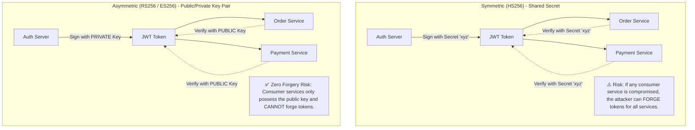
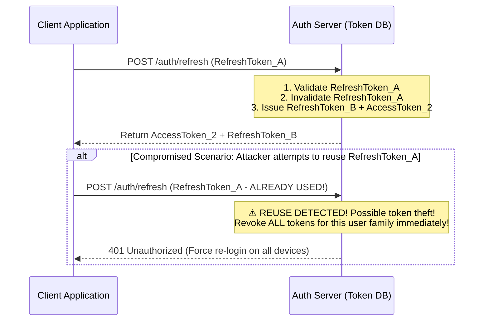

# JSON Web Tokens (JWT): Architecture, Algorithms & Revocation

A JSON Web Token (RFC 7519) is a compact, URL-safe means of representing claims to be transferred between two parties. When used correctly, JWTs enable stateless authentication without querying a central session database on every HTTP request.

---

## 1. Anatomy of a JWT

A JWT consists of three base64url-encoded parts separated by dots (`.`):

$$\underbrace{\text{Header}}_{\text{Algorithm \& Key ID}} \mathbf{.} \underbrace{\text{Payload}}_{\text{Claims \& Expiration}} \mathbf{.} \underbrace{\text{Signature}}_{\text{Cryptographic Proof}}$$

### Standard Registered Claims
- `sub` (Subject): The unique user or principal ID (e.g., UUID `usr_9f82c1a0`).
- `iss` (Issuer): URL or identifier of the issuing authority (e.g., `https://auth.example.com/`).
- `aud` (Audience): The intended recipient service (e.g., `https://api.example.com/orders`).
- `exp` (Expiration Time): Unix timestamp after which the token is invalid.
- `iat` (Issued At): Unix timestamp when the token was generated.
- `nbf` (Not Before): Token cannot be accepted prior to this timestamp.

---

## 2. Signing Algorithms: Symmetric (HS256) vs. Asymmetric (RS256 / ES256)

- **HS256 (HMAC with SHA-256)**: Single shared secret for both signing and verification. Acceptable only in single-monolith setups where signing and verification occur inside the exact same codebase.
- **RS256 (RSA with SHA-256) / ES256 (ECDSA using P-256 and SHA-256)**: Industry standard for microservices. The authorization server retains the private key; all downstream APIs verify tokens using the published public key (`JWKS` endpoint). **ES256** produces significantly smaller token signatures (64 bytes vs 256 bytes) with higher cryptographic strength.

---

## 3. Token Rotation & Lifecycle: Access vs. Refresh Tokens

Stateless access tokens cannot be arbitrarily recalled without introducing state. Therefore:
1. **Access Tokens MUST be short-lived**: 5 to 15 minutes max.
2. **Refresh Tokens are long-lived**: 7 to 30 days, stored securely (HttpOnly cookie on web, OS Keychain/Keyring on mobile).

### Refresh Token Rotation with Automatic Theft Detection
When a client presents a refresh token to obtain a new access token, the auth server **invalidates the old refresh token and issues a new one** (One-Time Use).

---

## 4. The 3 Production Revocation Strategies

When a user logs out, resets their password, or is banned, how do you revoke active stateless JWTs before they expire?

### Strategy 1: Centralized Redis Blacklist / Denylist
- On logout, store the token's unique identifier (`jti`) or the token string in Redis with a TTL equal to the remaining lifetime of the token:
  $$\text{Redis TTL} = \text{token.exp} - \text{current\_time}$$
- Downstream APIs check Redis on incoming requests:
  `if redis.exists("blacklist:" + jti): return 401`
- *Pros*: Immediate revocation; keys auto-expire from Redis so memory usage remains small.
- *Cons*: Re-introduces a Redis lookup on requests, partially negating statelessness.

### Strategy 2: User Token Version / Epoch (Database-Backed)
- In the user database table, maintain a `token_version: int = 1`.
- Include the user's current version inside the JWT payload: `{"sub": "123", "tv": 1}`.
- On password reset or "logout everywhere", increment the user's version:
  `UPDATE users SET token_version = token_version + 1 WHERE id = 123;`
- Service layers compare token `tv` with user `token_version`. If `token.tv < user.token_version`, reject the token.
- *Pros*: Invalidates all active tokens across all devices in a single SQL operation.

### Strategy 3: Hybrid Cache Invalidation
- APIs verify signatures locally without touching databases.
- A pub/sub broadcast (Redis Pub/Sub or Kafka topic `user-revocations`) publishes user ID revocation events.
- Downstream services maintain an in-memory L1 Bloom filter or set of banned user IDs for the duration of the max token TTL (e.g. 15 minutes).

---

## 5. High-Risk JWT Exploits & Security Mitigations

### 1. The `alg: "none"` Exploit
- **Vulnerability**: Early implementations accepted tokens where the header specified `{"alg": "none"}` with an empty signature block.
- **Defense**: Explicitly configure the JWT verification library to require an exact allowed algorithm whitelist:
  `jwt.decode(token, key, algorithms=["RS256"])` — **never allow `algorithms` to be dynamic from the token header**.

### 2. Key Confusion Attack (Asymmetric vs. Symmetric)
- **Vulnerability**: An attacker takes an RS256 public key (which is publicly visible) and signs a forged token using HMAC-SHA256 (`HS256`), using the public key string as the HMAC secret! If the backend server's verification code naively accepts whatever algorithm is in the header, it verifies the forged token using the public key as a symmetric key.
- **Defense**: Strictly whitelist and enforce the expected algorithm on the verifier side.

### 3. Sensitive Data in Payload
- **Vulnerability**: Storing credit cards, passwords, or PII in JWT payloads.
- **Fact**: Standard JWT payloads are **NOT encrypted**; they are merely base64url encoded and can be decoded by anyone with access to the token.
- **Defense**: Store only non-sensitive identifiers (`sub`, `roles`, `tenant_id`) in claims. If sensitive data must be transmitted, use **JWE (JSON Web Encryption)**.
