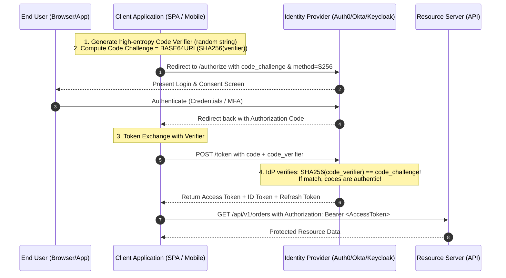
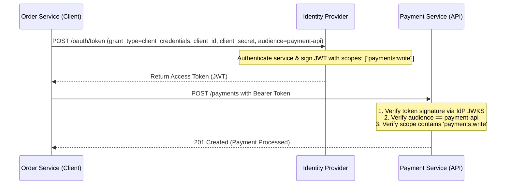

# OAuth 2.0 & OpenID Connect (OIDC): Modern Flows & PKCE

OAuth 2.0 (RFC 6749) is an **authorization delegation framework**; OpenID Connect (OIDC) is an **identity layer built on top of OAuth 2.0**. Understanding the distinction between identity (Authentication) and permissions (Authorization) is critical:

- **OIDC ID Token**: JWT intended for the **client application** containing identity claims (`name`, `email`, `sub`). Used to log the user into the client.
- **OAuth Access Token**: Token (opaque string or JWT) intended for the **Resource Server (API)** to authorize API requests.

---

## 1. Modern OAuth 2.1 Flow Selection Matrix

OAuth 2.1 officially **deprecates** the insecure **Implicit Grant** (which returned tokens in URL fragments) and the **Resource Owner Password Credentials Grant** (which encouraged sending user passwords directly to third parties).

| Scenario / Client Type | Recommended Grant Type | Security Requirements |
|---|---|---|
| **Single-Page Apps (SPA - React, Vue)** | **Authorization Code with PKCE** | `client_secret` omitted; PKCE mandatory; refresh token rotation. |
| **Mobile & Native Desktop Apps (iOS, Android, MAUI)** | **Authorization Code with PKCE** | Custom URI scheme / Universal links; token stored in OS Keyring. |
| **Server-Rendered Web Apps (Confidential Client)** | **Authorization Code with PKCE + Client Secret** | Client secret stored securely on server; tokens never exposed to browser. |
| **Machine-to-Machine / Microservices (M2M)** | **Client Credentials Grant** | Pre-shared `client_id` and `client_secret` or signed private key JWT. |
| **Input-Constrained Devices (Smart TVs, CLI tools)** | **Device Authorization Grant** | Secondary authorization on phone/browser via user code (RFC 8628). |

---

## 2. Authorization Code Flow with PKCE (Proof Key for Code Exchange)

PKCE (RFC 7636) prevents authorization code interception attacks on public clients (SPAs and mobile apps) that cannot securely store a `client_secret`.



---

## 3. Machine-to-Machine (M2M): Client Credentials Grant

When microservices communicate without user context, they authenticate using their own identity:



---

## 4. Scopes vs. Roles vs. Claims: Clean Authorization Modeling

A common design flaw is conflating scopes with user roles:

- **Scopes (`scp` / `scope`)**: What the **application** is permitted to do on behalf of the user (e.g. `read:orders`, `write:profile`). Scopes represent delegated permissions, not user job titles.
- **Roles (`roles`)**: What the **user** is allowed to do within an organization (e.g. `Admin`, `BillingManager`, `SupportAgent`). Roles belong in claims, not client scopes.
- **Claims**: Key-value identity attributes asserted by the token (e.g. `tenant_id: "acme_corp"`, `email_verified: true`).

```json
{
  "iss": "https://auth.acme.com/",
  "sub": "usr_42",
  "aud": "https://api.acme.com",
  "scope": "orders:read orders:write",
  "https://acme.com/roles": ["OrderManager"],
  "https://acme.com/tenant_id": "tenant_99"
}
```

---

## 5. Token Verification: JWKS Key Rotation & Caching

Instead of hardcoding RSA public keys into microservices, Resource Servers fetch public keys dynamically from the Identity Provider's **JSON Web Key Set (JWKS)** endpoint: `https://auth.example.com/.well-known/jwks.json`.

### Verification Algorithm:
1. Extract the `kid` (Key ID) from the JWT header:
   ```json
   { "alg": "RS256", "typ": "JWT", "kid": "key-2026-q1" }
   ```
2. Look up the matching `kid` in the local in-memory JWKS cache.
3. If not found in cache, fetch the latest JWKS from the IdP (with rate limiting / cooldown to prevent DoS).
4. Verify signature using the matching public key certificate.
5. Validate standard claims: `exp` (not expired), `nbf`, `iss` (matches expected IdP), and `aud` (matches your API).

