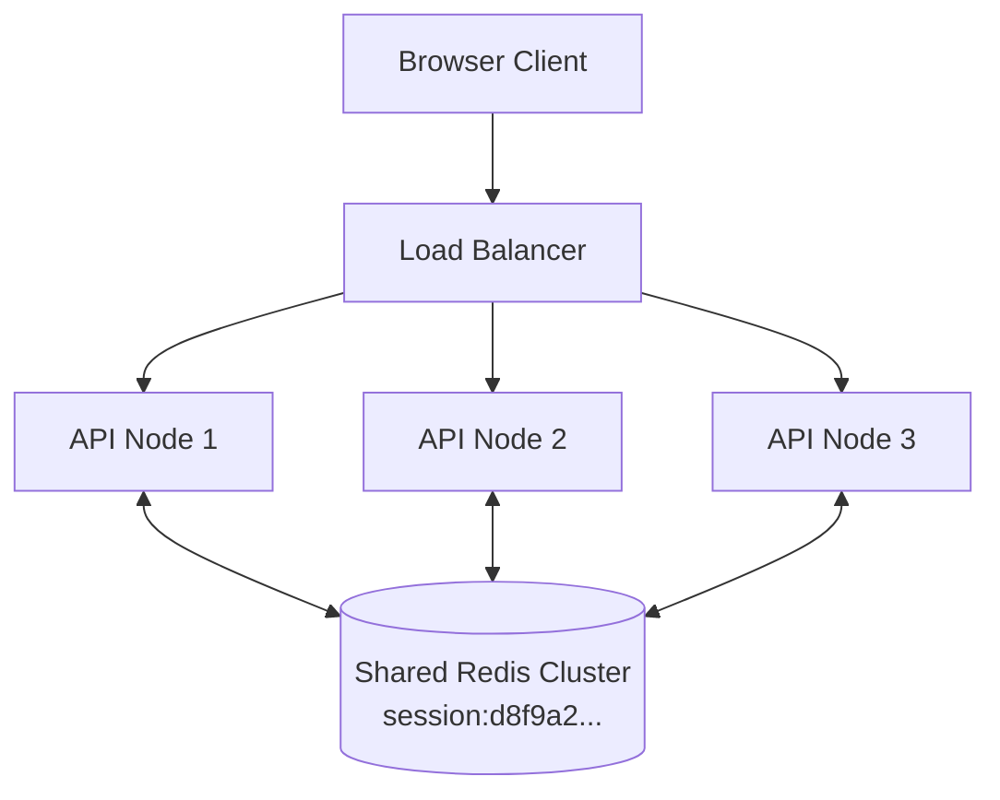

# Stateful Sessions, Cookies & CSRF Defense

For browser-based web applications, server-managed **stateful session tokens** stored in `HttpOnly` cookies remain the gold standard for security and instant revocation. Unlike stateless JWTs, sessions can be terminated on-demand from the server by deleting the session key.

---

## 1. The Anatomy of a Secure Cookie

Never store raw JSON objects, user permissions, or database IDs directly inside browser cookies. A cookie must contain only an unguessable, cryptographically random **Session ID** (minimum 128 bits of entropy from a CSPRNG):

```http
Set-Cookie: session_id=d8f9a2e3b1c47019e4a8...; Path=/; Domain=example.com; HttpOnly; Secure; SameSite=Lax; Max-Age=86400
```

### Mandatory Security Flags:
- **`HttpOnly`**: Blocks client-side JavaScript access (`document.cookie`). If the application suffers from a Cross-Site Scripting (XSS) vulnerability, the attacker **cannot exfiltrate the session token**.
- **`Secure`**: Enforces that the browser will only transmit the cookie over encrypted TLS/HTTPS connections. Prevents cleartext packet sniffing on public Wi-Fi.
- **`SameSite=Lax` (Default)**: Restricts the cookie from being sent on cross-origin sub-requests (such as ``, `<iframe>`, or `fetch()` from another website). Mitigates 95% of CSRF attacks out of the box.
- **`SameSite=Strict`**: The cookie is NEVER sent on cross-site requests, even when following an external hyperlink (e.g., clicking a link from an email). Best suited for high-security banking/financial portals.

---

## 2. Session Lifecycle & Session Fixation Defense

A **Session Fixation Attack** occurs when an attacker obtains a valid session ID, injects it into a victim's browser (e.g. via an unauthenticated link), and waits for the victim to log in. If the server does not rotate the session ID upon authentication, the attacker uses the known session ID to hijack the authenticated account.

### The Fixation Defense Rule:
**Always regenerate and re-issue a new Session ID immediately upon login and privilege elevation.**

```mermaid
sequenceDiagram
    participant User as User Browser
    participant App as Web Server
    participant Redis as Session Store (Redis)

    Note over User,App: 1. Anonymous browsing (Anonymous Session A)
    User->>App: POST /auth/login (username, password)
    Note over App: Authenticate credentials successfully
    
    Note over App: ⚠️ DEFENSE: REGENERATE SESSION ID!
    App->>Redis: DELETE session:SessionA
    App->>Redis: SET session:SessionB {user_id: 42, role: "admin"} EX 86400
    App-->>User: Set-Cookie: session_id=SessionB; HttpOnly; Secure; SameSite=Lax
    Note over User: Session A is dead. Attacker's fixated cookie is useless.
```

---

## 3. Cross-Site Request Forgery (CSRF) Defense

Because browsers automatically include cookies with cross-origin requests, an attacker's website could submit a forged form: `<form action="https://bank.com/transfer" method="POST">`.

### Multi-Layered CSRF Defense Strategy:

#### Layer 1: Modern `SameSite` Attribute
Configuring `SameSite=Lax` or `SameSite=Strict` prevents modern browsers from sending cookies on cross-origin POST requests.

#### Layer 2: Origin & Referer Header Verification
Reject any state-changing HTTP request (`POST`, `PUT`, `DELETE`, `PATCH`) whose `Origin` or `Referer` header does not match your trusted API host:

```python
def verify_trusted_origin(request):
    origin = request.headers.get("origin") or request.headers.get("referer")
    if not origin or not is_trusted_domain(origin):
        raise Forbidden("Cross-origin request rejected")
```

#### Layer 3: Anti-CSRF Synchronizer Token (Double-Submit Pattern)
For older browsers or APIs with cross-subdomain architectures:
1. Generate a cryptographic random token per session.
2. Deliver the token to the frontend in a readable cookie (`csrf_token`) or custom response header.
3. On every state-changing request, the frontend must copy the token into a custom header: `X-CSRF-Token: <token>`.
4. The server verifies that the header token matches the session token. Because cross-origin scripts cannot read foreign cookies due to the Same-Origin Policy (SOP), an attacker cannot forge the header.

---

## 4. Horizontal Scalability with Distributed Session Stores

Storing sessions in local web server RAM breaks as soon as traffic is load-balanced across multiple instances.



- Store session data in a **Redis Cluster** using `SETEX session:<id> 86400 <json_data>`.
- Sliders: Extend session TTL on each active user request to implement inactivity timeouts.
- Eviction policy for session Redis: Configure `maxmemory-policy noeviction` to ensure active sessions are never silently dropped under memory pressure.

