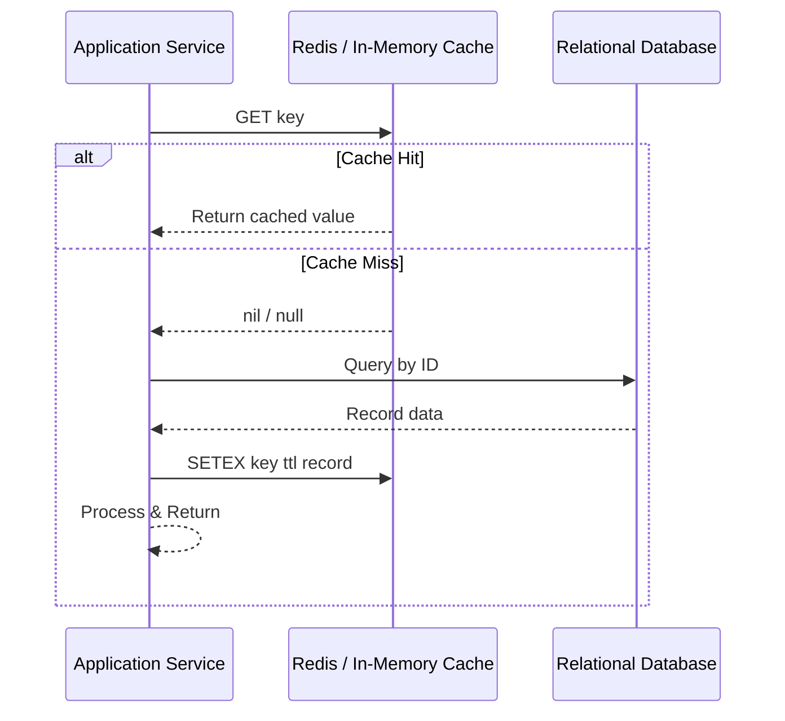
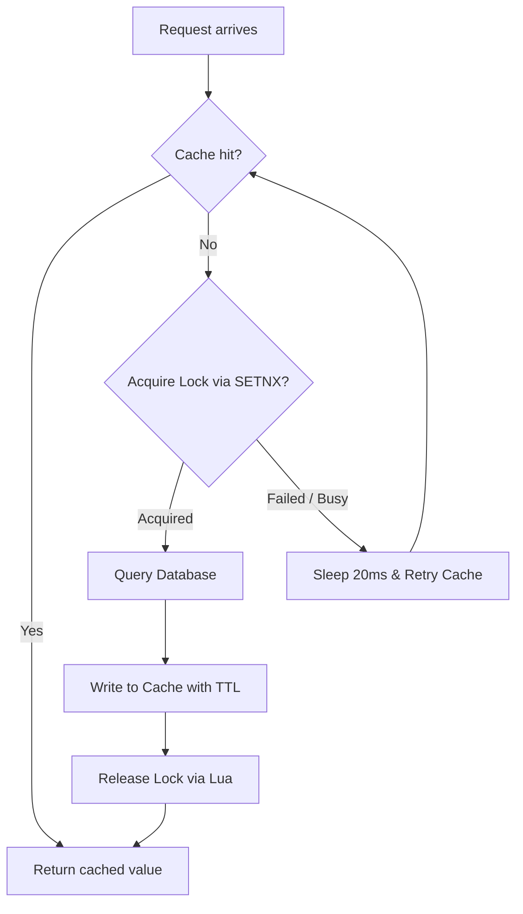

# Caching Patterns, Consistency & Stampede Defense

Caching is the primary architectural mechanism to achieve sub-millisecond read latency, decouple high-throughput frontends from relational storage, and absorb traffic spikes. However, caching introduces distributed state, cache invalidation complexity, and cold-start failure modes.

---

## 1. Primary Caching Topologies

| Topology | Latency Profile | Scalability | Consistency Risk | Best Suited For |
|---|---|---|---|---|
| **L1: In-Process / Local Cache** (`IMemoryCache`, `lru-cache`, `cachetools`, `Caffeine`) | Sub-microsecond (< 1 µs) | Single process memory; scales with instance count | High across instances (drift occurs without pub/sub eviction) | Immutable static lookups, high-frequency configuration, per-instance hot data. |
| **L2: Distributed Shared Cache** (Redis, Memcached) | 0.5 ms – 2.0 ms (network roundtrip) | Horizontally scalable (Redis Cluster / Sentinel) | Low (single source of truth for cache layer) | User sessions, shared API response cache, rate limit counters, distributed locks. |
| **Multi-Tier: Hybrid Cache (L1 + L2)** (.NET 9 `HybridCache`, custom L1-with-Redis-invalidation) | < 1 µs for L1 hit; ~1 ms for L2 hit | High throughput with reduced Redis network bandwidth | Medium (requires backplane invalidation message on mutation) | High-volume microservices where Redis network egress becomes a bottleneck. |

---

## 2. Read/Write Caching Strategies

### Cache-Aside (Lazy Loading)
The application code coordinates cache lookups and storage reads directly.

- **Pros**: Only requested data is cached (lazy); resilient to cache server restarts.
- **Cons**: Cache miss penalty on cold starts; potential data staleness if database is mutated without cache eviction.
- **Guidance**: The recommended default pattern for 90% of web APIs and microservices. Always set an explicit TTL (`EXPIRE`).

### Write-Through
The application writes data to the cache; the cache synchronously updates the database before acknowledging the write.
- **Pros**: Read consistency is preserved immediately; zero cache miss on newly created items.
- **Cons**: Increased write latency (two synchronous writes).

### Write-Behind (Write-Back)
The application writes immediately to the cache and receives an instant ACK; an asynchronous background worker or queue batches and flushes writes to the database.
- **Pros**: Blazing fast write throughput; absorbs write bursts (e.g., IoT telemetry, view counts, game leaderboards).
- **Cons**: Risk of data loss if the cache node crashes before the dirty write buffer is flushed to durable storage.

### Refresh-Ahead
The cache automatically predicts and reloads keys from the database before they expire based on access frequency.
- **Pros**: Eliminates cache miss latency for hot keys.
- **Cons**: Difficult to accurately predict access patterns; potential wasted database queries for abandoned keys.

---

## 3. Cache Stampede (Thundering Herd) Defense

A **Cache Stampede** occurs when a heavily requested hot key expires (or on cold system startup), causing thousands of concurrent requests to experience a cache miss simultaneously. All concurrent requests fall through to the database at the same instant, saturating DB connections and causing service outages.

### Defense Strategy A: Mutex / Distributed Lock (Single-Flight Pattern)
Only the first request acquiring the lock queries the database; all other concurrent requests wait briefly and re-check the cache.

### Defense Strategy B: Probabilistic Early Expiration (XFetch Algorithm)
Instead of waiting for the key to expire at $t_{\text{expire}}$, compute a probabilistic check based on remaining TTL, computation time $\delta$, and an exploration factor $\beta$:

$$\Delta t - \beta \cdot \delta \cdot \ln(\text{random}()) \le 0$$

If true, the current reading thread proactively recalculates the cache value in the background before expiration occurs, guaranteeing a zero-downtime refresh without concurrent locks. (Built natively into .NET 9 `HybridCache` and advanced Redis clients).

---

## 4. Key Eviction Policies & Sizing

When Redis memory exceeds `maxmemory`, the configured eviction policy dictates which keys are evicted:

| Eviction Policy | Mechanism | When to Choose |
|---|---|---|
| `volatile-lru` | Least Recently Used among keys with an expiration (`TTL`) set. | Standard application caching where some keys are persistent configuration. |
| `allkeys-lru` | Least Recently Used across all keys, regardless of TTL. | Pure cache-only Redis instances where all data can be recreated from a database. |
| `volatile-lfu` | Least Frequently Used among keys with TTL (tracks counter hits). | Workloads with long-tail access patterns where sporadic spikes shouldn't evict steady hot keys. |
| `allkeys-lfu` | Least Frequently Used across all keys. | Cache-only instances prioritizing frequently accessed records over recent bursts. |
| `noeviction` | Returns an error `OOM command not allowed` when memory is full. | When Redis is used as a primary store, queue, or session store where data loss is intolerable. |

