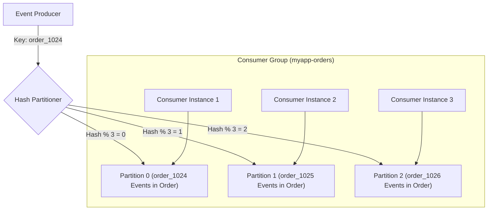
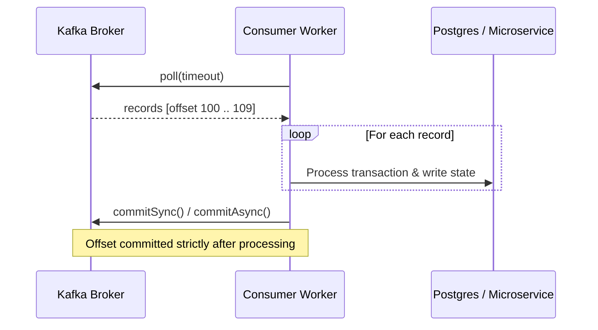
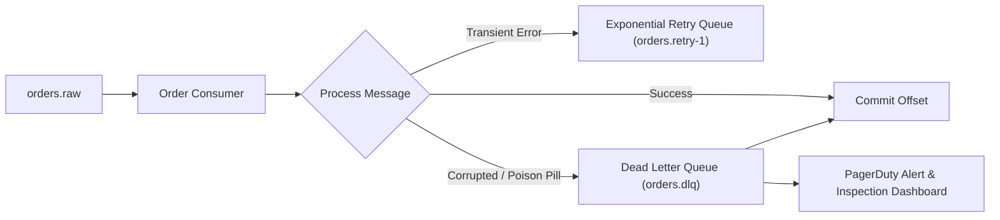
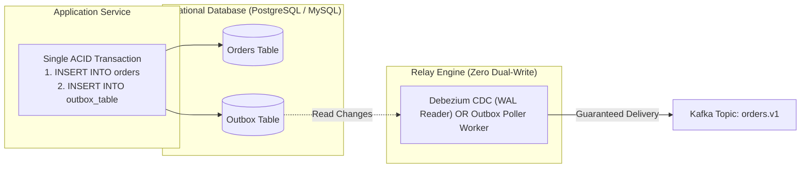

# Apache Kafka Architecture, Streaming & Queue Patterns

Apache Kafka is a distributed, append-only commit log designed for high-throughput, partitioned, fault-tolerant event streaming. Unlike traditional ephemeral message queues, Kafka retains messages for configurable durations (hours, days, or indefinitely) and allows multiple independent consumer groups to replay history at their own pace.

---

## 1. When to Use Kafka vs. Alternatives

| Engine / Pattern | Throughput Profile | Ordering Guarantee | Replayability | Message Retention | Optimal Use Case |
|---|---|---|---|---|---|
| **Apache Kafka** | Millions/sec | Strict per partition | Yes (arbitrary offset seek) | Days/Years (durable commit log) | Central event backbone, CDC (Debezium), audit log, stream processing (Kafka Streams/Flink), high-scale microservice decoupling. |
| **RabbitMQ** | Tens of thousands/sec | Strict per queue FIFO | No (deleted on ACK) | Ephemeral (until consumed) | Complex routing (Exchange: topic, fanout, headers), RPC request-response, per-message priority and TTL. |
| **Redis Streams** | Hundreds of thousands/sec | Strict per stream ID | Yes (via ID seek) | Memory-bound (with `MAXLEN` cap) | Fast lightweight event streaming inside existing Redis infrastructure without running JVM Kafka cluster. |
| **Redis Pub/Sub** | Millions/sec | Best effort | No (fire-and-forget; lost if offline) | Zero retention | Real-time chat, live UI notifications, cache invalidation signals. |
| **Cloud SQS / PubSub** | High (auto-scaled) | FIFO queues or standard | No (deleted on ACK) | 14 days max | Serverless pipelines, low-maintenance cloud architectures where operational zero-ops is prioritized over raw throughput. |

---

## 2. Partitions, Keys & Ordering Guarantees



### Critical Ordering Rules
1. **Ordering is Guaranteed ONLY Per Partition**:
   - Kafka guarantees strict sequential ordering within a single partition.
   - There is **NO global ordering** across different partitions within the same topic.
2. **Partition Key Selection**:
   - Always specify a deterministic business key (e.g., `tenant_id`, `user_id`, `order_id`) when state mutations for an entity must be processed sequentially.
   - If no key is provided (`null`), Kafka round-robins messages across partitions, losing ordering.
3. **Partition Skew (Hot Partition Trap)**:
   - If an uneven key is chosen (e.g. `country_code = 'US'` for an 80% US userbase), 80% of traffic floods a single partition, starving consumer concurrency while other partitions sit idle.
   - *Mitigation*: Salt heavy keys (`user_123_salt1`, `user_123_salt2`) or partition by finer-grained IDs.

---

## 3. Offset Commit Hygiene & At-Least-Once Delivery

### The Auto-Commit Trap (`enable.auto.commit = true`)
- **How It Fails**: The consumer background thread automatically commits offsets every `auto.commit.interval.ms` (default 5000ms), regardless of whether message processing has finished.
- **Scenario A (Data Loss)**: Consumer polls 100 messages. Auto-commit commits offset 100. Consumer crashes while processing message 12. On restart, the new consumer starts at offset 101; messages 12–100 are **permanently lost**.
- **Scenario B (Excessive Reprocessing)**: Consumer processes messages 1–90. Before the 5-second auto-commit interval ticks, consumer crashes. New consumer re-starts at offset 0 and re-executes all 90 messages.

### The Production Standard: Manual Synchronous / Asynchronous Commit
Disable auto-commit and commit only **after** business logic completes successfully:



---

## 4. Poison Pill Messages & Dead Letter Queues (DLQ)

A **Poison Pill** is a malformed message (corrupted JSON, unexpected schema, null byte) that causes the consumer deserializer or business logic to throw an unhandled exception every time it is polled.
- Without proper DLQ handling, the consumer restarts or retries indefinitely, halting all subsequent messages in that partition (**Head-of-Line Blocking**).

### Recommended DLQ Routing Architecture


---

## 5. Idempotent Producer & Exactly-Once Semantics (EOS)

- **Idempotent Producer** (`enable.idempotence = true`):
  - Prevents duplicate messages produced by network retries.
  - The broker tracks a unique `ProducerId` and monotonic `SequenceNumber` per batch; duplicates are deduplicated by the broker with zero client-side logic.
- **Transactional Producer & Consumer** (`processing.guarantee = "exactly_once_v2"`):
  - Used in read-process-write stream pipelines (consuming from Topic A, mutating state, producing to Topic B).
  - Offsets and produced messages are committed within a single distributed two-phase transaction.

---

## 6. Producer Implementation Best Practices & Tuning

When implementing Kafka producers in application services, apply these configuration heuristics:

| Configuration Property | Recommended Value | Why / Impact |
|---|---|---|
| `acks` | `all` (or `-1`) | **Durability Guarantee**: Forces the leader broker to wait until all in-sync replicas (`min.insync.replicas=2`) acknowledge the write before returning success. Never use `acks=0` (blind send) or `acks=1` (leader only) for critical financial or business data. |
| `enable.idempotence` | `true` (default in Kafka 3.0+) | **Duplicate Defense**: Automatically prevents duplicate records if network glitches trigger producer retries. Broker deduplicates by `ProducerId + SequenceNumber`. |
| `compression.type` | `lz4` or `zstd` | **Throughput & Network**: Compresses message batches before transmission. `lz4` provides an optimal balance of ultra-fast compression and low CPU overhead; `zstd` provides higher compression ratios for text/JSON. |
| `linger.ms` | `5` to `20` ms | **Micro-Batching**: Introduces a negligible buffer delay to allow multiple events to accumulate into a single batch, drastically increasing compression efficiency and throughput without human-perceptible latency. |
| `batch.size` | `32768` to `65536` (32–64 KB) | Sets maximum size per partition batch. Default 16 KB is often too small for high-throughput microservices. |
| `max.in.flight.requests.per.connection` | `5` (with idempotence enabled) | Maximizes network pipeline pipelining while preserving strict sequential ordering on partition retries. |
| `retries` | `2147483647` (Int.MaxValue) | Let `delivery.timeout.ms` (e.g. 120,000 ms) control overall timeout rather than arbitrary retry counts. |

---

## 7. Consumer Implementation Best Practices & Rebalance Defense

Kafka consumers are **single-threaded per instance** and coordinate partition assignments through a cluster group coordinator. Poor consumer implementations trigger catastrophic "rebalance storms".

### 1. The Rebalance Starvation Trap
- If message processing takes longer than `max.poll.interval.ms` (default 300,000 ms / 5 min), the broker assumes the consumer has hung or died.
- The coordinator revokes its partitions and triggers a cluster-wide **Group Rebalance**.
- While the rebalance occurs, **all consumption in the group stops**.
- When the new consumer picks up the partition, it encounters the same slow batch, exceeding `max.poll.interval.ms` again, creating an **infinite rebalance storm**.

### 2. Consumer Tuning Heuristics
- **Tune `max.poll.records`**: Lower the batch size (e.g. `50` to `200` records) based on maximum downstream processing time:
  $$\text{max.poll.records} \times \text{max\_single\_record\_duration\_ms} \le 0.5 \times \text{max.poll.interval.ms}$$
- **Enable Cooperative Sticky Assignor**:
  ```properties
  partition.assignment.strategy = org.apache.kafka.clients.consumer.CooperativeStickyAssignor
  ```
  Kafka 2.4+ replaced the legacy "Eager" protocol (which revoked all partitions from all consumers during a rebalance) with the **Incremental Cooperative protocol**, which only moves affected partitions while unaffected consumers continue processing uninterrupted.
- **Heartbeat & Session Timeouts**:
  - `session.timeout.ms = 45000` (45s)
  - `heartbeat.interval.ms = 15000` (15s — strictly $\frac{1}{3}$ of session timeout)

### 3. Graceful Consumer Teardown
Never terminate a consumer with `SIGKILL` or unhandled exit. On `SIGTERM` / `SIGINT`:
1. Signal the consumer loop cancellation flag (`stoppingToken` in C#, `threading.Event` in Python, `consumer.disconnect()` in JS).
2. Allow in-flight processed records to finish.
3. Commit final processed offsets via synchronous commit (`commitSync()`).
4. Close consumer cleanly via `consumer.close()`, which immediately sends a `LeaveGroup` request to the coordinator, triggering an instant partition reassignment without waiting for `session.timeout.ms` to expire.

---

## 8. Dual-Write Elimination: The Transactional Outbox Pattern

A fundamental anti-pattern in microservices is updating a relational database and immediately publishing an event to Kafka in two separate operations:

```
❌ THE DUAL-WRITE HAZARD:
1. db.saveOrder(order)    --> SUCCESS
2. kafka.produce(order)   --> NETWORK CRASH / TIMEOUT
Result: Order is in DB, but downstream services never received the event (State Inconsistency).
```

### The Production Solution: Transactional Outbox
Combine the database write and event capture into a **single ACID transaction**:



- **Option A (Debezium CDC)**: Reads the database Write-Ahead Log (WAL) directly and streams outbox inserts to Kafka with near-zero latency and zero application polling overhead.
- **Option B (Scheduled Polling Worker)**: Selects unprocessed rows with `SELECT ... FOR UPDATE SKIP LOCKED`, publishes to Kafka, and marks rows processed.

---

## 9. Topic Design, Partitioning & Capacity Sizing

| Architectural Dimension | Production Recommendation | Rationale |
|---|---|---|
| **Replication Factor** | `3` | Withstands loss of 1 broker while still having a redundant copy during maintenance restarts. |
| **`min.insync.replicas`** | `2` | Guarantees that at least 2 brokers must acknowledge writes when `acks=all`, preventing single-node write acknowledgements. |
| **Partition Count Sizing** | Start with **6 to 12 partitions** per topic | Number of partitions determines the maximum number of parallel consumers in a group. Sizing rule: $\max(\frac{\text{Target Throughput}}{\text{Consumer Throughput}}, \frac{\text{Target Throughput}}{\text{Producer Throughput}})$. |
| **Payload Format** | **Schema Registry** (Avro / Protobuf / JSON Schema) | Strict contract evolution. Prevents producers from pushing breaking schema changes (e.g. removing fields) that crash downstream consumers. |
| **Log Compaction (`cleanup.policy=compact`)** | State snapshot topics (e.g. `user-current-balances`) | Retains only the latest value for each partition key, enabling consumers to reconstruct complete system state on cold boot. |

---

## 10. Implementation Code Review Checklist (Quick Reference)

- [ ] **Durability**: Is `acks=all` configured on business-critical producers?
- [ ] **Idempotence**: Is `enable.idempotence=true` explicitly set or verified?
- [ ] **Compression**: Is `compression.type` set to `lz4` or `zstd`?
- [ ] **Rebalance Safety**: Is `max.poll.records` sized small enough to prevent exceeding `max.poll.interval.ms` on slow downstream batches?
- [ ] **Sticky Assignor**: Is `CooperativeStickyAssignor` enabled to avoid stop-the-world rebalance pauses?
- [ ] **Offset Commit Timing**: Are offsets committed **after** processing rather than before?
- [ ] **Poison Pill Defense**: Is deserialization wrapped in a try-catch block routing malformed messages to a DLQ?
- [ ] **No Dual-Writes**: Are cross-system database mutations paired with Kafka events using the Transactional Outbox pattern?

