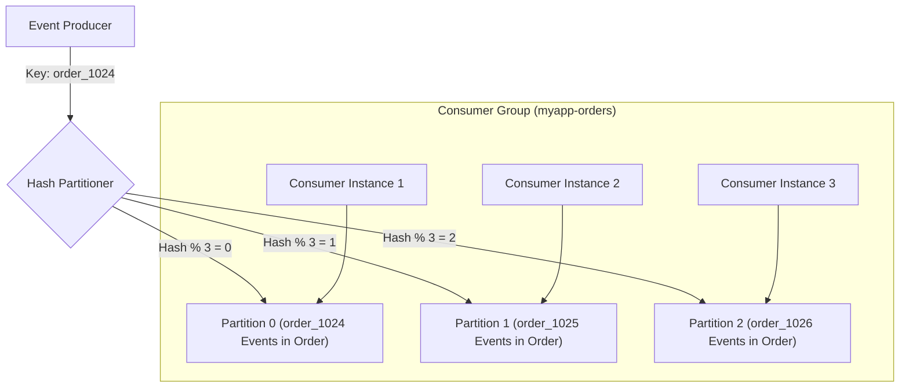
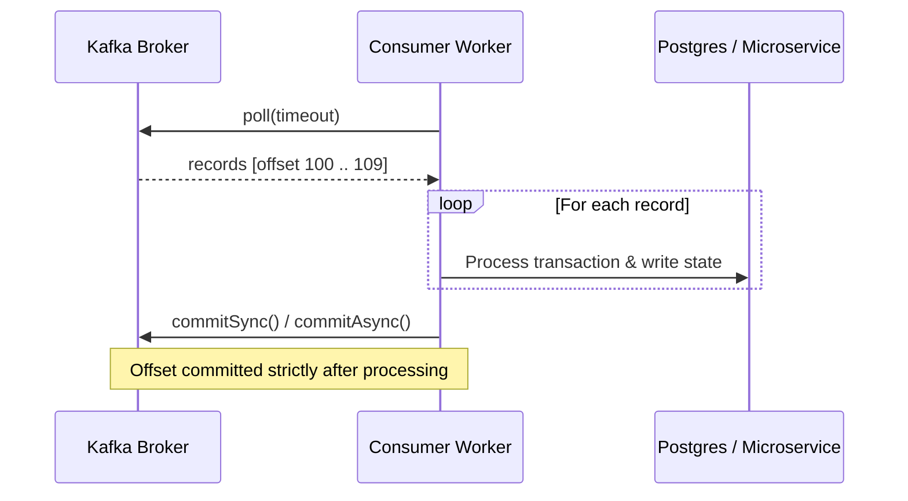

# Apache Kafka Architecture, Streaming & Queue Patterns

Apache Kafka is a distributed, append-only commit log designed for high-throughput, partitioned, fault-tolerant event streaming. Unlike traditional ephemeral message queues, Kafka retains messages for configurable durations (hours, days, or indefinitely) and allows multiple independent consumer groups to replay history at their own pace.

---

## 1. When to Use Kafka vs. Alternatives

| Engine / Pattern | Throughput Profile | Ordering Guarantee | Replayability | Message Retention | Optimal Use Case |
|---|---|---|---|---|---|
| **Apache Kafka** | Millions/sec | Strict per partition | Yes (arbitrary offset seek) | Days/Years (durable commit log) | Central event backbone, CDC (Debezium), audit log, stream processing (Kafka Streams/Flink), high-scale microservice decoupling. |
| **RabbitMQ** | Tens of thousands/sec | Strict per queue FIFO | No (deleted on ACK) | Ephemeral (until consumed) | Complex routing (Exchange: topic, fanout, headers), RPC request-response, per-message priority and TTL. |
| **Redis Streams** | Hundreds of thousands/sec | Strict per stream ID | Yes (via ID seek) | Memory-bound (with `MAXLEN` cap) | Fast lightweight event streaming inside existing Redis infrastructure without running JVM Kafka cluster. |
| **Redis Pub/Sub** | Millions/sec | Best effort | No (fire-and-forget; lost if offline) | Zero retention | Real-time chat, live UI notifications, cache invalidation signals. |
| **Cloud SQS / PubSub** | High (auto-scaled) | FIFO queues or standard | No (deleted on ACK) | 14 days max | Serverless pipelines, low-maintenance cloud architectures where operational zero-ops is prioritized over raw throughput. |

---

## 2. Partitions, Keys & Ordering Guarantees



### Critical Ordering Rules
1. **Ordering is Guaranteed ONLY Per Partition**:
   - Kafka guarantees strict sequential ordering within a single partition.
   - There is **NO global ordering** across different partitions within the same topic.
2. **Partition Key Selection**:
   - Always specify a deterministic business key (e.g., `tenant_id`, `user_id`, `order_id`) when state mutations for an entity must be processed sequentially.
   - If no key is provided (`null`), Kafka round-robins messages across partitions, losing ordering.
3. **Partition Skew (Hot Partition Trap)**:
   - If an uneven key is chosen (e.g. `country_code = 'US'` for an 80% US userbase), 80% of traffic floods a single partition, starving consumer concurrency while other partitions sit idle.
   - *Mitigation*: Salt heavy keys (`user_123_salt1`, `user_123_salt2`) or partition by finer-grained IDs.

---

## 3. Offset Commit Hygiene & At-Least-Once Delivery

### The Auto-Commit Trap (`enable.auto.commit = true`)
- **How It Fails**: The consumer background thread automatically commits offsets every `auto.commit.interval.ms` (default 5000ms), regardless of whether message processing has finished.
- **Scenario A (Data Loss)**: Consumer polls 100 messages. Auto-commit commits offset 100. Consumer crashes while processing message 12. On restart, the new consumer starts at offset 101; messages 12–100 are **permanently lost**.
- **Scenario B (Excessive Reprocessing)**: Consumer processes messages 1–90. Before the 5-second auto-commit interval ticks, consumer crashes. New consumer re-starts at offset 0 and re-executes all 90 messages.

### The Production Standard: Manual Synchronous / Asynchronous Commit
Disable auto-commit and commit only **after** business logic completes successfully:



---

## 4. Poison Pill Messages & Dead Letter Queues (DLQ)

A **Poison Pill** is a malformed message (corrupted JSON, unexpected schema, null byte) that causes the consumer deserializer or business logic to throw an unhandled exception every time it is polled.
- Without proper DLQ handling, the consumer restarts or retries indefinitely, halting all subsequent messages in that partition (**Head-of-Line Blocking**).

### Recommended DLQ Routing Architecture
```mermaid
flowchart LR
    TopicIn[orders.raw] --> Consumer[Order Consumer]
    Consumer --> Process{Process Message}
    Process -- Success --> Commit[Commit Offset]
    Process -- Transient Error --> Retry[Exponential Retry Queue (orders.retry-1)]
    Process -- Corrupted / Poison Pill --> DLQ[Dead Letter Queue (orders.dlq)]
    DLQ --> Alert[PagerDuty Alert & Inspection Dashboard]
    DLQ --> Commit
```

---

## 5. Idempotent Producer & Exactly-Once Semantics (EOS)

- **Idempotent Producer** (`enable.idempotence = true`):
  - Prevents duplicate messages produced by network retries.
  - The broker tracks a unique `ProducerId` and monotonic `SequenceNumber` per batch; duplicates are deduplicated by the broker with zero client-side logic.
- **Transactional Producer & Consumer** (`processing.guarantee = "exactly_once_v2"`):
  - Used in read-process-write stream pipelines (consuming from Topic A, mutating state, producing to Topic B).
  - Offsets and produced messages are committed within a single distributed two-phase transaction.
