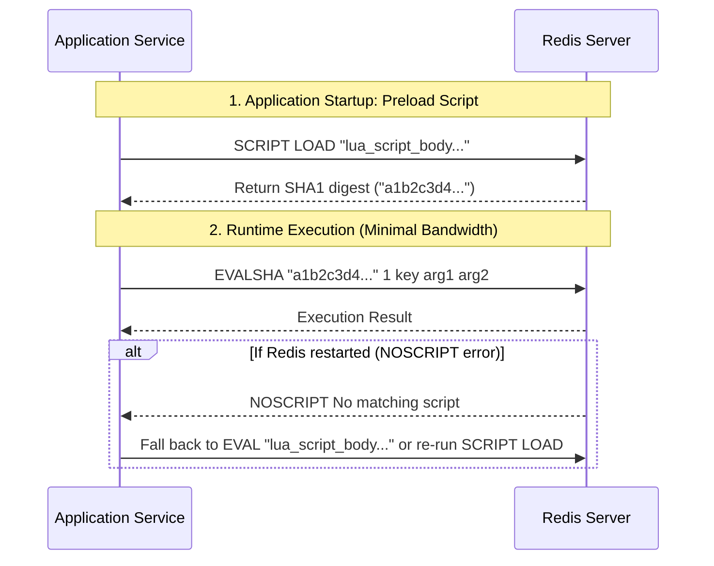

# Redis Lua Scripting: Atomicity, Patterns & Safety

Redis executes Lua scripts **atomically** within its single-threaded command processing loop. No other client command can execute while a Lua script is running. This guarantees transactional isolation without the race conditions inherent to multi-step `WATCH`/`MULTI`/`EXEC` pipelines.

---

## 1. When to Use Lua Scripts in Redis

| Requirement | Use Lua Script? | Alternative | Why Lua is Preferred |
|---|:---:|---|---|
| **Check-Then-Act Race Condition** (e.g. read value, compare, then write) | **YES** | Multi/Exec with `WATCH` | `WATCH` aborts under concurrent contention, forcing client retries. Lua executes atomically in one roundtrip with zero contention aborts. |
| **Distributed Lock Safe Release** | **YES** | Simple `DEL` | A simple `DEL` can release a lock acquired by another process if the first process's TTL expired while executing. |
| **Sliding Window Rate Limiter** | **YES** | Multiple ZSET commands over network | Multiple network roundtrips (`ZREMRANGEBYSCORE`, `ZCARD`, `ZADD`, `EXPIRE`) introduce race conditions and latency; Lua batches them into a single atomic step. |
| **Simple Atomic Counters** | **NO** | `INCR` / `HINCRBY` | Redis built-in atomic commands are faster and require no script engine parsing. |
| **Heavy Data Processing / Iteration** | **NO** | Client-side processing or background workers | Long-running Lua scripts block the entire Redis instance for all other clients. |

---

## 2. Essential Production Lua Script Patterns

### Pattern 1: Distributed Lock Release (Token Ownership Verification)
When releasing a distributed lock, verify that the caller is the legitimate owner by comparing the caller's unique UUID token against the stored lock value before deleting.

```lua
-- KEYS[1] = lock_key (e.g. "lock:order:1024")
-- ARGV[1] = lock_owner_token (e.g. "uuid-worker-77")

if redis.call("GET", KEYS[1]) == ARGV[1] then
    return redis.call("DEL", KEYS[1])
else
    return 0
end
```

### Pattern 2: Atomic Token Bucket Rate Limiter
Enforces a maximum burst capacity and a continuous refill rate without clock synchronization issues.

```lua
-- KEYS[1] = rate_limit_key (e.g. "rate:user:42")
-- ARGV[1] = max_capacity (e.g. 100)
-- ARGV[2] = refill_rate_per_second (e.g. 10)
-- ARGV[3] = current_timestamp_seconds (e.g. 1718000000)
-- ARGV[4] = requested_tokens (e.g. 1)

local data = redis.call("HMGET", KEYS[1], "tokens", "last_updated")
local tokens = tonumber(data[1])
local last_updated = tonumber(data[2])

local capacity = tonumber(ARGV[1])
local refill_rate = tonumber(ARGV[2])
local now = tonumber(ARGV[3])
local requested = tonumber(ARGV[4])

if tokens == nil then
    tokens = capacity
    last_updated = now
else
    local elapsed = math.max(0, now - last_updated)
    tokens = math.min(capacity, tokens + (elapsed * refill_rate))
    last_updated = now
end

if tokens >= requested then
    tokens = tokens - requested
    redis.call("HMSET", KEYS[1], "tokens", tokens, "last_updated", last_updated)
    redis.call("EXPIRE", KEYS[1], math.ceil(capacity / refill_rate) * 2)
    return {1, math.floor(tokens)} -- Allowed: 1, remaining tokens
else
    redis.call("HMSET", KEYS[1], "tokens", tokens, "last_updated", last_updated)
    return {0, math.floor(tokens)} -- Denied: 0, remaining tokens
end
```

### Pattern 3: Sliding Window Rate Limiter (ZSET)
Accurately limits actions within a moving time window (e.g., max 60 requests in the rolling last 60 seconds).

```lua
-- KEYS[1] = rate_limit_key (e.g. "ratelimit:ip:192.168.1.1")
-- ARGV[1] = now_timestamp_ms
-- ARGV[2] = window_size_ms (e.g. 60000)
-- ARGV[3] = max_requests (e.g. 60)
-- ARGV[4] = unique_request_id (UUID)

local key = KEYS[1]
local now = tonumber(ARGV[1])
local window = tonumber(ARGV[2])
local max_req = tonumber(ARGV[3])
local req_id = ARGV[4]

local clear_before = now - window
redis.call("ZREMRANGEBYSCORE", key, "-inf", clear_before)

local current_count = redis.call("ZCARD", key)
if current_count < max_req then
    redis.call("ZADD", key, now, req_id)
    redis.call("PEXPIRE", key, window)
    return 1 -- Allowed
else
    return 0 -- Rejected (Rate limit exceeded)
end
```

---

## 3. Execution & Optimization: `EVAL` vs. `EVALSHA`

Sending raw Lua scripts over the network with `EVAL` on every request wastes network bandwidth and requires Redis to compile the script repeatedly.



Modern client libraries (`ioredis`, `redis-py`, `StackExchange.Redis`) handle `EVALSHA` caching and `NOSCRIPT` transparently via Lua script helper methods.

---

## 4. Lua Scripting Traps & Production Guardrails

1. **The Single-Thread Blocker**:
   - Because Lua runs atomically, any script running for > 5 ms blocks **ALL** other concurrent requests to the Redis server.
   - Never perform unbounded loops or iterate through large keys.
   - If a script exceeds `busy-reply-timeout` (default 5 seconds), Redis begins rejecting other clients with `BUSY Redis is busy running a script`.
2. **Deterministic Scripting Requirement**:
   - Redis enforces reproducible execution. Do not use random numbers (`math.random()`) or system time unless passed in explicitly via `ARGV`.
3. **Redis Cluster Hash Tag Requirement**:
   - In a Redis Cluster environment, all keys accessed by a Lua script must belong to the **same hash slot**.
   - Use curly braces `{}` to force keys to the same slot:
     `KEYS[1] = "{order:1024}:lock"` and `KEYS[2] = "{order:1024}:history"`.
   - Accessing keys with different hash slots results in: `CROSSSLOT Keys in request don't hash to the same slot`.
