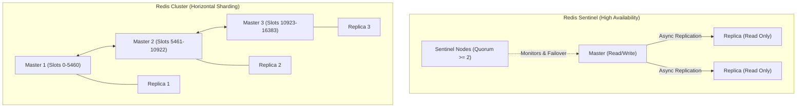

# Redis Architecture & Data Structure Selection

Redis is an in-memory, single-threaded (event loop core with background I/O threads) key-value data structure store. Selecting the right Redis data structure directly dictates memory efficiency, algorithmic complexity, and throughput.

---

## 1. Data Structure Selection Matrix

| Structure | Typical Commands | Big-O Complexity | Optimal Use Cases | Anti-Patterns |
|---|---|---|---|---|
| **String** | `GET`, `SET`, `INCR`, `SETNX`, `MGET` | $O(1)$ per key | JSON blobs, serialized objects, atomic counters, distributed lock tokens. | Storing large nested objects where only single fields change frequently (causes full serialization overhead). |
| **Hash** | `HGET`, `HSET`, `HGETALL`, `HINCRBY` | $O(1)$ per field; $O(N)$ for `HGETALL` | User profiles, entity records with mutable fields, session attributes. | Calling `HGETALL` or `HKEYS` on hashes with > 10,000 fields (blocks Redis event loop). |
| **List** | `LPUSH`, `RPOP`, `BRPOP`, `LRANGE` | $O(1)$ head/tail; $O(N)$ random access | Lightweight FIFO queues, recent activity logs, bounded event timelines (`LTRIM`). | Using `LINDEX` or `LRANGE` with large offsets on deep lists ($O(N)$ traversal). |
| **Set** | `SADD`, `SREM`, `SISMEMBER`, `SINTER` | $O(1)$ add/remove/check; $O(N)$ set operations | Unique tags, user follower IDs, deduplication filters, IP blacklists. | Running `SMEMBERS` on sets with millions of items; use `SSCAN` instead. |
| **Sorted Set (ZSet)** | `ZADD`, `ZREM`, `ZRANGEBYSCORE`, `ZREVRANGE` | $O(\log N)$ add/remove; $O(\log N + M)$ range | Leaderboards, sliding window rate limiters, priority queues, scheduled job timestamps. | Storing unbounded elements without pruning; huge score ranges. |
| **Stream** | `XADD`, `XREAD`, `XREADGROUP`, `XACK` | $O(1)$ append; $O(M)$ read chunk | Distributed append-only event logs, multi-consumer group event streaming, message broker. | Leaving stream unpruned without `MAXLEN ~ 100000` (causes unbounded RAM growth). |
| **Bitmap** | `SETBIT`, `GETBIT`, `BITCOUNT`, `BITOP` | $O(1)$ bit access; $O(N/8)$ count | Daily active user (DAU) tracking, binary feature flags, high-density boolean tracking. | Setting a high bit offset (e.g., bit 4 billion) on an empty key, which immediately allocates 512 MB. |
| **HyperLogLog** | `PFADD`, `PFCOUNT`, `PFMERGE` | $O(1)$ add; $O(1)$ count | Approximate unique cardinality counting (unique visitors) with 0.81% error rate in fixed 12 KB RAM. | Exact billing or auditing where 100% precision is required. |

---

## 2. High Availability: Sentinel vs. Cluster

### When to Use Redis Sentinel
- Dataset fits within a single server's RAM (e.g., < 32 GB).
- High availability with automated failover is required.
- Simpler client configuration and zero cross-slot command limitations.

### When to Use Redis Cluster
- Dataset exceeds the RAM of a single physical machine (e.g., hundreds of GBs).
- Throughput exceeds 100,000+ ops/sec and saturates a single CPU core.
- **Limitation**: Multi-key operations (`MGET`, transactions, Lua scripts) require all keys in the command to map to the same hash slot using hash tags: `{user:123}:profile` and `{user:123}:orders`.

---

## 3. Persistence: RDB vs. AOF

- **RDB (Redis Database Snapshot)**: Point-in-time binary snapshots saved to disk at intervals (e.g., every 5 minutes).
  - *Pros*: Compact file size, faster restart/restore times.
  - *Cons*: Potential data loss between snapshot intervals (e.g., losing last 5 minutes of writes).
- **AOF (Append Only File)**: Logs every write command received by the server (`appendfsync everysec`).
  - *Pros*: Maximum durability; at most 1 second of data loss.
  - *Cons*: Larger file size, slower restart time, background rewrite CPU overhead.
- **Recommended Production Standard**: Use **Hybrid RDB + AOF** (`aof-use-rdb-preamble yes`). Fast recovery via RDB base, augmented with tail AOF replay.

---

## 4. Performance & Memory Hygiene

1. **Avoid Blocking Commands**:
   - Never run `KEYS *`, `FLUSHALL`, `FLUSHDB`, or `HGETALL` on large keys in production.
   - Use non-blocking scan iterations: `SCAN`, `HSCAN`, `SSCAN`, `ZSCAN`.
2. **Pipelining**:
   - Send batches of commands in a single network roundtrip to eliminate per-command network RTT latency ($10\times$ throughput increase).
3. **Big Key Traps**:
   - Single keys containing > 10 MB or collections with > 50,000 items block Redis when allocated, read, or evicted.
   - Audit with `redis-cli --bigkeys` or `MEMORY USAGE <key>`.
