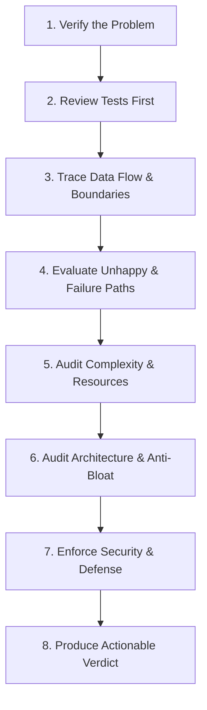

# Code Reviewer Reference Guide

Advanced code review strategies, cognitive heuristics, multi-agent pipeline integration, language-specific checklist matrices, and specialized domain auditing guides.

---

## 1. Review Heuristics & Cognitive Biases

A senior code reviewer approaches code with a disciplined engineering lens and actively mitigates cognitive biases:



### Review Heuristics
1. **Verify the Problem First**:
   - Before reading single lines of code, read the user requirements, issue description, or architectural spec.
   - Ask: *"Does this patch actually solve the problem it claims to solve?"*
2. **Review Tests Before Implementation**:
   - Inspect test files first. Do the tests prove the new behavior? Do they fail when the behavior is broken?
   - If tests only cover the golden path, flag missing edge cases immediately.
3. **Trace the Data Flow**:
   - Follow external inputs from the entrypoint (HTTP controller, event listener, or CLI command) down to database/disk and back.
   - Look for missing sanitization, unvalidated type casts, and state mutations.
4. **Assume Unhappy Paths**:
   - What happens when network disconnects or times out?
   - What happens if the database returns 0 rows or violates a unique constraint?
   - What happens if disk is full or read-only?
   - What happens if concurrent requests arrive with the exact same ID or token?

### Mitigating Review Cognitive Biases
- **Bikeshedding (Parkinson's Law of Triviality)**: Do not spend 80% of review energy arguing over formatting, spacing, or variable naming while ignoring complex concurrency or SQL table scans. Let automated linters (`ruff`, `eslint`, `dotnet format`) handle syntax and formatting.
- **Anchoring Bias**: Do not assume the author's chosen design pattern is necessary just because they wrote code for it. Check whether the problem could be solved with simpler, existing constructs.
- **Review Fatigue**: When reviewing large diffs (> 300 lines), break review into passes: first architecture and tests, then edge cases and security, then style and nits.

---

## 2. Multi-Agent Pipeline Review Protocol (`agent-orchestrator`)

When acting as the reviewer sub-agent during Stage 3 (`codereview`) in the multi-agent development lifecycle:

1. **Accept Bounded Stage Context**:
   - Inspect upstream artifacts: `plan.md` and the list of changed files from Stage 2 (`develop`).
   - Do not pull unbounded raw chat history.
2. **Execute Systematic Review Passes**:
   - Pass 1: Functional correctness & test authenticity (consult [`scan-halucinated-tests`](file:///.github/skills/scan-halucinated-tests/SKILL.md)).
   - Pass 2: Language-specific idioms and resource hygiene (consult dedicated language modules below).
   - Pass 3: Domain deep audits (API Security, SQL execution plans, Distributed caching/queues).
3. **Evaluate Quality Gate**:
   - **PASS**: 0 Blocker (`[P0]`) and 0 Major (`[P1]`) issues found.
   - **FAIL / BLOCKED**: Any `[P0]` or `[P1]` defect detected.
4. **Record Verdict**:
   ```bash
   python .github/skills/agent-orchestrator/scripts/orchestrator-context-manager.py record \
     --stage codereview \
     --status PASSED \
     --summary "Clean review: 0 blocking issues, 2 minor suggestions addressed" \
     --artifact "review.md"
   ```

---

## 3. Language-Specific Review Directory Map

The code reviewer organizes checklist standards into dedicated language directories matching the codebase developer skills:

| Language / Stack | Core Checklist | Deep Specialized Modules | Companion Developer Skill |
|---|---|---|---|
| **SQL** | [SQL Checklist](file:///.github/skills/code-reviewer/sql/sql-review-checklist.md) | [Indexing & Execution Plans](file:///.github/skills/code-reviewer/sql/indexing-and-execution-plans-review.md)<br>[Procedures, TVFs & Cursors](file:///.github/skills/code-reviewer/sql/procedures-tvfs-and-cursors-review.md)<br>[Analytics & Windowing](file:///.github/skills/code-reviewer/sql/analytics-and-windowing-review.md) | [`sql-executor`](file:///.github/skills/sql-executor/SKILL.md)<br>[`sql-connector`](file:///.github/skills/sql-connector/SKILL.md) |
| **Python** | [Python Checklist](file:///.github/skills/code-reviewer/python/python-review-checklist.md) | [Web API Review (FastAPI/Django)](file:///.github/skills/code-reviewer/python/web-api-review.md)<br>[Concurrency & Memory](file:///.github/skills/code-reviewer/python/concurrency-and-memory-review.md) | [`python-developer`](file:///.github/skills/python-developer/SKILL.md)<br>[`python-api-writer`](file:///.github/skills/python-api-writer/SKILL.md) |
| **TypeScript / Node** | [TypeScript Checklist](file:///.github/skills/code-reviewer/typescript/typescript-review-checklist.md) | [Node & Runtime Memory](file:///.github/skills/code-reviewer/typescript/node-and-runtime-review.md)<br>[Async & Concurrency](file:///.github/skills/code-reviewer/typescript/async-and-concurrency-review.md) | [`typescript-developer`](file:///.github/skills/typescript-developer/SKILL.md) |
| **React / Next.js** | [React Checklist](file:///.github/skills/code-reviewer/react/react-review-checklist.md) | [Hooks & Rendering Performance](file:///.github/skills/code-reviewer/react/hooks-and-rendering-review.md)<br>[State & Data Fetching](file:///.github/skills/code-reviewer/react/state-and-data-fetching-review.md)<br>[RSC & Next.js](file:///.github/skills/code-reviewer/react/rsc-and-nextjs-review.md) | [`react-developer`](file:///.github/skills/react-developer/SKILL.md) |
| **Java** | [Java Checklist](file:///.github/skills/code-reviewer/java/java-review-checklist.md) | [Spring Boot & JPA Data](file:///.github/skills/code-reviewer/java/spring-boot-and-data-review.md)<br>[Virtual Threads & JVM](file:///.github/skills/code-reviewer/java/concurrency-and-jvm-review.md) | [`java-developer`](file:///.github/skills/java-developer/SKILL.md) |
| **C# (.NET)** | [C# Checklist](file:///.github/skills/code-reviewer/csharp/csharp-review-checklist.md) | [ASP.NET Core & EF Core](file:///.github/skills/code-reviewer/csharp/aspnet-and-efcore-review.md)<br>[Performance, Channels & Span](file:///.github/skills/code-reviewer/csharp/performance-and-runtime-review.md) | [`csharp-developer`](file:///.github/skills/csharp-developer/SKILL.md) |
| **Go** | [Go Checklist](file:///.github/skills/code-reviewer/go/go-review-checklist.md) | [Concurrency, Channels & Runtime](file:///.github/skills/code-reviewer/go/concurrency-and-runtime-review.md) | — |

---

## 4. Specialized Domain Review Guides

### A. SQL & Relational Databases
When reviewing SQL queries, migrations, or ORM data access, cross-reference [`sql-executor`](file:///.github/skills/sql-executor/SKILL.md):
- **Destructive SQL Firewall**: Raw `DROP TABLE`, `TRUNCATE`, or unconstrained `DELETE` statements trigger immediate `[P0 - Blocker]`.
- **Execution Plans**: Run `explain_query` or examine query plans to ensure indexes (B-Tree, GIN, BRIN) eliminate $O(N)$ full table scans.
- **SARGability**: Columns in `WHERE` clauses must not be wrapped in scalar functions (`WHERE UPPER(col) = ...`).
- **CTEs vs. Temporary Tables**: In SQL Server and Oracle, complex multi-step queries must materialize intermediate sets into indexed `#temp` tables to avoid re-evaluating costly CTEs.
- **Table-Valued Functions (TVFs)**: Inline TVFs must be preferred over multi-statement TVFs to permit optimizer predicate pushdown.

### B. Distributed Caching & Message Queues
When inspecting code that uses Redis, Kafka, or RabbitMQ, cross-reference [`caching-queues-reviewer`](file:///.github/skills/caching-queues-reviewer/SKILL.md):
- **Redis Distributed Locks**: Lock acquisition must include a TTL, and release must use an atomic Lua script verifying token ownership.
- **Cache Stampede Prevention**: Hot keys must be protected using probabilistic early expiration (XFetch), mutex locks, or .NET `HybridCache`.
- **Kafka Producer Idempotency**: `enable.idempotence=true` must be configured, with partition keys distributed to prevent hot partition skew.
- **Consumer Reliability**: Failed messages must route to a Dead-Letter Queue (DLQ) with exponential backoff rather than infinite retry loops.
- **Transactional Outbox**: Database state changes and message publications must be coordinated via the Outbox pattern rather than dual-write antipatterns.

### C. API Security & Authentication
When reviewing controllers, middleware, or auth handlers, cross-reference [`api-security`](file:///.github/skills/api-security/SKILL.md):
- **JWT Algorithms**: Asymmetric algorithms (RS256, ES256) must be enforced; algorithm `none` and symmetric HS256 for public tokens must be rejected.
- **OAuth 2.1 PKCE**: Proof Key for Code Exchange (S256 code challenge) must be enforced for authorization code grants.
- **Session Cookie Flags**: Session cookies must be configured with `HttpOnly; Secure; SameSite=Strict` (or `Lax`).
- **API Key Security**: API keys must be hashed (SHA-256) at rest rather than stored in plaintext.

### D. Architecture & Anti-Bloat Auditing
When reviewing abstractions, interfaces, and module structure, cross-reference [`detect-overengineering`](file:///.github/skills/detect-overengineering/SKILL.md):
- **Layer Depth**: Call chains must be limited to $\le 3$ layers (e.g., Controller $\to$ Service $\to$ Repository).
- **Speculative Interfaces**: Interfaces with only one implementation and no polymorphism or test mock justification must be flattened.
- **Trampoline Methods**: Pass-through methods that simply forward arguments to the next layer without transformation or logic must be eliminated.

---

## 5. Review Severity Standards & Concrete Examples

Categorize all comments using standard priority prefixes:

| Severity | Label | Definition | Action Required |
|---|---|---|---|
| **P0** | `[P0 - Blocker]` | Critical bug, data loss, security flaw, raw destructive SQL, unhandled exception in core path. | Must be fixed before code can be accepted. |
| **P1** | `[P1 - Major]` | Missing error handling, unhandled edge case, severe memory leak, unindexed $O(N)$ table scan, missing unit tests. | Must be resolved before merge. |
| **P2** | `[P2 - Minor]` | Anti-pattern, code duplication, suboptimal performance, confusing naming, premature abstraction. | Strongly recommended fix; can be addressed in follow-up. |
| **P3** | `[P3 - Nit]` | Minor cosmetic preference, formatting nitpick, documentation typo. | Optional improvement. |

### Concrete Review Comment Patterns

#### Example 1: `[P0 - Blocker]` Destructive Unconstrained SQL
```markdown
#### [P0 - Blocker] Unconstrained DELETE in account cleanup routine
- **Location:** `src/db/cleanup.sql:14`
- **Observation:** `DELETE FROM accounts;` lacks a `WHERE` clause.
- **Impact:** Wipes the entire accounts table on execution.
- **Suggested Fix:**
```sql
- DELETE FROM accounts;
+ DELETE FROM accounts WHERE is_deleted = TRUE AND deleted_at < NOW() - INTERVAL '30 days';
```
```

#### Example 2: `[P1 - Major]` Unindexed Table Scan & Non-SARGable Predicate
```markdown
#### [P1 - Major] Non-SARGable predicate forces full table scan on 2M rows
- **Location:** `src/repositories/UserRepository.cs:58`
- **Observation:** `WHERE UPPER(Email) == email.ToUpper()` wraps indexed column in a scalar function.
- **Impact:** Forces EF Core to generate non-SARGable SQL resulting in an $O(N)$ Clustered Index Scan.
- **Suggested Fix:**
```csharp
- var user = await _context.Users.FirstOrDefaultAsync(u => u.Email.ToUpper() == email.ToUpper(), cancellationToken);
+ // Ensure case-insensitive collation or index on normalized email
+ var user = await _context.Users.AsNoTracking().FirstOrDefaultAsync(u => u.NormalizedEmail == normalizedEmail, cancellationToken);
```
```

#### Example 3: `[P2 - Minor]` Layer Bloat / Trampoline Method
```markdown
#### [P2 - Minor] Unnecessary trampoline layer in order processing
- **Location:** `src/services/OrderManager.ts:22`
- **Observation:** `OrderManager.process()` simply forwards arguments to `OrderService.process()` with no logic or transformation.
- **Impact:** Adds unnecessary cognitive overhead and extra call-stack indirection (YAGNI violation).
- **Suggested Fix:** Call `OrderService` directly from the route handler and remove the redundant `OrderManager` wrapper.
```

---

## 6. References

- [API Security](file:///.github/skills/api-security/SKILL.md) — Universal API authentication, token security, and cryptographic audit.
- [Caching & Queues Reviewer](file:///.github/skills/caching-queues-reviewer/SKILL.md) — Redis, Kafka, and RabbitMQ architecture and code review.
- [SQL Executor](file:///.github/skills/sql-executor/SKILL.md) — Multi-engine SQL query tuning, indexing, and validation.
- [SQL Connector MCP Server](file:///.github/skills/sql-connector/SKILL.md) — Multi-database query and schema inspection with zero-tolerance SQL guardrails.
- [Detect Overengineering](file:///.github/skills/detect-overengineering/SKILL.md) — Anti-bloat heuristics and YAGNI auditing.
- [Algorithmic Complexity Analyzer](file:///.github/skills/algorithmic-complexity-analyzer/SKILL.md) — Time and space complexity auditing.
- [Troubleshoot and Fix](file:///.github/skills/troubleshoot-and-fix/SKILL.md) — Isolated testbed reproduction and 3-iteration circuit breaker remediation.
- [Scan Hallucinated Tests](file:///.github/skills/scan-halucinated-tests/SKILL.md) — AST ground-truth test verification.
