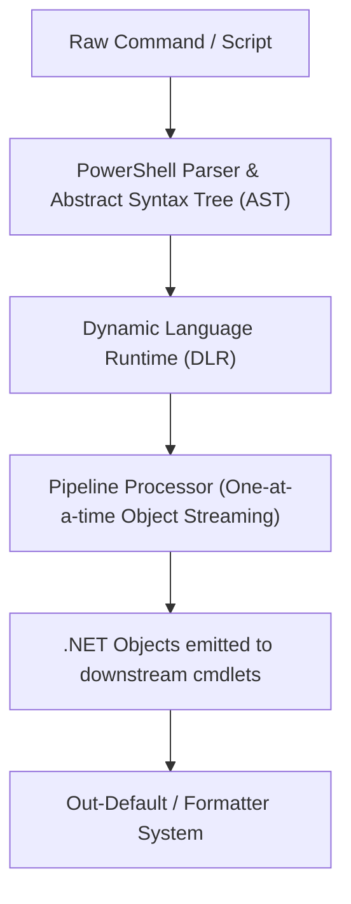

# PowerShell Writer Reference Guide

Advanced architectural patterns, runtime internals, cross-platform compatibility, and performance optimization for PowerShell engineering.

---

## 1. PowerShell Architecture & Runtime Internals

PowerShell is built on top of .NET (`CoreCLR` in PowerShell 7+, `.NET Framework` in Windows PowerShell 5.1).



### Key Internal Concepts:
- **Object Pipeline**: Instead of byte streams, objects pass by reference between cmdlets in the same process.
- **DLR Optimization**: Repeated pipeline invocations are compiled to dynamic call sites, making pipeline loops competitive with compiled C# code when avoiding array reallocations.
- **ExecutionContext & Scopes**:
  - Global (`$global:`): Persists across the entire user session. **Avoid** in modular code.
  - Script (`$script:`): Shared within a single `.ps1` or `.psm1` file.
  - Local: Function-scoped; automatically destroyed upon function return.

---

## 2. Cross-Platform Compatibility (PowerShell 7 vs. Windows PowerShell 5.1)

If authoring cross-platform scripts (Windows, Linux, macOS) or multi-version modules:

| Feature / Behavior | Windows PowerShell 5.1 | PowerShell 7.4+ LTS |
|---|---|---|
| Runtime | .NET Framework 4.8 | .NET 8.0 CoreCLR |
| Path separator | `\` | Works with `/` and `\` |
| Ternary Operator | Not supported (use `if/else`) | `condition ? trueVal : falseVal` |
| Null-Coalescing | Not supported | `$val ?? 'default'`, `$val ??= 'init'` |
| Null-Conditional | Not supported | `$obj?.Property`, `$arr?[0]` |
| `ForEach-Object -Parallel` | Not supported | Built-in native threading |
| `ConvertTo-Json -Depth` | Defaults to 2 (TRUNCATES!) | Defaults to 2 (TRUNCATES!) — Always pass `-Depth 10` |
| Native Exit Codes | `$LASTEXITCODE` manual check | `$PSNativeCommandUseErrorActionPreference = $true` |

### Cross-Platform Path Handling:
Never hardcode backslashes `\`:
```powershell
# BAD: Breaks on Linux/macOS
$path = "$PSScriptRoot\Config\settings.json"

# GOOD: Portable Join-Path
$path = Join-Path -Path $PSScriptRoot -ChildPath 'Config' | Join-Path -ChildPath 'settings.json'

# OR .NET System.IO.Path
$path = [System.IO.Path]::Combine($PSScriptRoot, 'Config', 'settings.json')
```

---

## 3. Production Script Template (`template.ps1`)

Use this boilerplate for standalone operational scripts:

```powershell
<#
.SYNOPSIS
    Automated deployment and health verification script.
.DESCRIPTION
    Executes service verification, data migrations, and triggers endpoint testing.
.PARAMETER Environment
    Target environment (Dev, Staging, Production).
.PARAMETER Force
    Bypasses interactive confirmation prompts.
.EXAMPLE
    ./deploy.ps1 -Environment Staging -Verbose
#>
[CmdletBinding(SupportsShouldProcess = $true)]
param(
    [Parameter(Mandatory = $true, Position = 0)]
    [ValidateSet('Dev', 'Staging', 'Production')]
    [string]$Environment,

    [Parameter()]
    [switch]$Force
)

# 1. Enforce strict execution and stop on any unhandled error
$ErrorActionPreference = 'Stop'
Set-StrictMode -Version Latest

# 2. Track execution time and logging
$stopwatch = [System.Diagnostics.Stopwatch]::StartNew()
Write-Verbose "Starting execution for Environment: $Environment at $([System.DateTime]::UtcNow.ToString('o'))"

try {
    # 3. Validation and prerequisite verification
    if (-not (Test-Path -Path "$PSScriptRoot/config.$Environment.json")) {
        throw "Configuration file for '$Environment' not found at '$PSScriptRoot/config.$Environment.json'."
    }

    # 4. Core operation guarded by ShouldProcess
    if ($Force -or $PSCmdlet.ShouldProcess($Environment, "Deploy updates to target environment")) {
        Write-Host "Deploying updates to $Environment..." -ForegroundColor Cyan

        # Execute workload
        $config = Get-Content -Raw -Path "$PSScriptRoot/config.$Environment.json" | ConvertFrom-Json -AsHashtable
        Write-Verbose "Loaded configuration with $($config.Keys.Count) keys."

        # Emit completion payload
        [PSCustomObject]@{
            Environment  = $Environment
            Status       = 'Completed'
            DurationMs   = $stopwatch.ElapsedMilliseconds
            TimestampUtc = [System.DateTime]::UtcNow
        }
    }
}
catch {
    Write-Error -Message "Fatal deployment error: $($_.Exception.Message)" `
                -Category OperationStopped
    exit 1
}
finally {
    $stopwatch.Stop()
    Write-Verbose "Script execution finished in $($stopwatch.ElapsedMilliseconds)ms."
}
```

---

## 4. Performance Tuning & Benchmarking

Always measure before optimizing using `Measure-Command`:

```powershell
# Measure execution time
$elapsed = Measure-Command {
    1..50000 | ForEach-Object { $_ * 2 }
}
Write-Host "Pipeline took: $($elapsed.TotalMilliseconds)ms"
```

### High-Frequency Optimizations:
1. **Direct Loop vs. Pipeline**:
   - `foreach ($x in $arr)` is $3\times\text{--}5\times$ faster than `$arr | ForEach-Object { }` for small in-memory collections because it avoids pipeline object marshaling overhead.
   - For giant datasets that do not fit in RAM, `ForEach-Object` streaming is required.
2. **Avoid `$arr += $item`**:
   - Creates a new array and copies all elements every time.
   - Use `[System.Collections.Generic.List[T]]` or pipeline streaming instead.
3. **Regex Compilation**:
   - For high-frequency loops matching regex, compile the regex once:
   ```powershell
   $regex = [System.Text.RegularExpressions.Regex]::new('^[a-zA-Z0-9._%+-]+@[a-zA-Z0-9.-]+\.[a-zA-Z]{2,}$', [System.Text.RegularExpressions.RegexOptions]::Compiled)
   $isValid = $regex.IsMatch($email)
   ```

---

## 5. References & Cross-Skill Links

- [Cmdlet Design](file:///.github/skills/powershell-writer/core/advanced-functions-and-cmdlets.md)
- [Error Handling](file:///.github/skills/powershell-writer/core/error-handling-and-strictmode.md)
- [Anti-Bloat Guidelines](file:///.github/skills/powershell-writer/core/anti-bloat-and-overengineering.md)
- [Pipeline & Streaming](file:///.github/skills/powershell-writer/pipeline-and-streaming/pipeline-and-custom-objects.md)
- [Data & REST APIs](file:///.github/skills/powershell-writer/pipeline-and-streaming/data-parsing-and-rest.md)
- [Concurrency & Jobs](file:///.github/skills/powershell-writer/concurrency/jobs-and-parallelism.md)
- [Module Architecture](file:///.github/skills/powershell-writer/modules/module-architecture-and-manifests.md)
- [Security & Hardening](file:///.github/skills/powershell-writer/security/security-and-hardening.md)
- [Testing with Pester v5](file:///.github/skills/powershell-writer/testing/pester-and-scriptanalyzer.md)
- [Code Reviewer](file:///.github/skills/code-reviewer/SKILL.md) — Multi-language code review skill.
