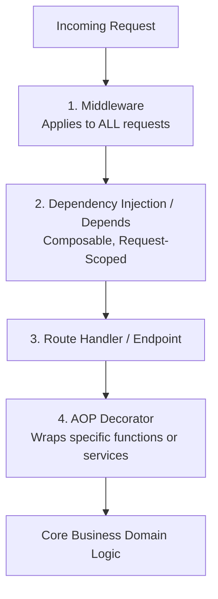

# Aspect-Oriented Programming (AOP) & Decorators in Python APIs

**Aspect-Oriented Programming (AOP)** modularizes **cross-cutting concerns**—such as authorization, distributed tracing, audit logging, rate limiting, retries, and database transactions—without tangling them into core business logic.

In Python, AOP is implemented primarily through **Decorators**, **FastAPI Dependencies**, and **Middleware**.

---

## 1. When to Use Which AOP Mechanism



| Mechanism | Scope | Best Suited For | What to Avoid |
|---|---|---|---|
| **Middleware** | Global (every HTTP request) | Correlation ID generation, CORS, Gzip compression, request size limits, global execution metrics. | Fine-grained route authorization or database session injection (runs outside route context). |
| **FastAPI `Depends()`** | Route / Endpoint scoped | Database sessions, current authenticated user, query parameter extraction, RBAC. | Reusable service-layer methods invoked outside of HTTP controllers (e.g. CLI or background tasks). |
| **AOP Decorators (`@decorator`)** | Function / Method scoped | Timing & performance tracing, exponential retries, service-level caching, audit logs, `@transaction.atomic`. | Hiding massive side effects that change parameter signatures or bypass type checkers. |

---

## 2. Writing Production-Grade AOP Decorators

### The 3 Rules of Python Decorators:
1. **Always use `@functools.wraps`**: Preserves function `__name__`, docstrings, module origin, and `__annotations__`.
2. **Support Both `async def` and `def`**: A production decorator must detect whether the target function is a coroutine using `inspect.iscoroutinefunction()`.
3. **Preserve FastAPI Signatures**: FastAPI reflects on parameter signatures (`inspect.signature`) to build OpenAPI documentation and resolve `Depends()`. A naive `*args, **kwargs` wrapper can strip parameters from generated `/docs`.

### Universal Dual Async/Sync AOP Decorator Pattern
```python
import functools
import inspect
import time
import logging
from collections.abc import Callable
from typing import Any, TypeVar

logger = logging.getLogger("audit")
F = TypeVar("F", bound=Callable[..., Any])

def audit_logged(action_name: str) -> Callable[[F], F]:
    """
    AOP Decorator: Measures execution time, logs input arguments, 
    and captures exceptions across both async and sync functions.
    """
    def decorator(func: F) -> F:
        if inspect.iscoroutinefunction(func):
            @functools.wraps(func)
            async def async_wrapper(*args: Any, **kwargs: Any) -> Any:
                start_time = time.perf_counter()
                logger.info(f"START {action_name} | fn={func.__name__}")
                try:
                    result = await func(*args, **kwargs)
                    duration_ms = (time.perf_counter() - start_time) * 1000
                    logger.info(f"SUCCESS {action_name} | duration={duration_ms:.2f}ms")
                    return result
                except Exception as ex:
                    duration_ms = (time.perf_counter() - start_time) * 1000
                    logger.error(f"FAIL {action_name} | err={ex} | duration={duration_ms:.2f}ms")
                    raise
            return async_wrapper  # type: ignore
        else:
            @functools.wraps(func)
            def sync_wrapper(*args: Any, **kwargs: Any) -> Any:
                start_time = time.perf_counter()
                logger.info(f"START {action_name} | fn={func.__name__}")
                try:
                    result = func(*args, **kwargs)
                    duration_ms = (time.perf_counter() - start_time) * 1000
                    logger.info(f"SUCCESS {action_name} | duration={duration_ms:.2f}ms")
                    return result
                except Exception as ex:
                    duration_ms = (time.perf_counter() - start_time) * 1000
                    logger.error(f"FAIL {action_name} | err={ex} | duration={duration_ms:.2f}ms")
                    raise
            return sync_wrapper  # type: ignore

    return decorator
```

---

## 3. Core AOP Patterns in Production APIs

### Pattern 1: Resilience Aspect (Exponential Backoff Retry with Jitter)
Avoid writing manual `for attempt in range(...)` loops across external HTTP/database calls:

```python
# Using Tenacity (Industry-standard AOP retry library)
from tenacity import retry, stop_after_attempt, wait_exponential_jitter, retry_if_exception_type
import httpx

@retry(
    stop=stop_after_attempt(3),
    wait=wait_exponential_jitter(initial=1, max=10, jitter=1),
    retry=retry_if_exception_type((httpx.RequestError, httpx.HTTPStatusError)),
    reraise=True
)
async def fetch_exchange_rates(currency: str) -> dict:
    """Retries up to 3 times on network or 5xx failures with randomized jitter."""
    async with httpx.AsyncClient() as client:
        response = await client.get(f"https://api.rates.internal/v1/{currency}")
        response.raise_for_status()
        return response.json()
```

### Pattern 2: Cache-Aside Aspect with Dynamic Key Generation
Encapsulate caching logic entirely in an aspect, leaving the service function clean:

```python
import functools
import hashlib
import json
from typing import Any, Callable

def cache_response(key_prefix: str, ttl_seconds: int = 300):
    """AOP Cache Aspect: Intercepts call, checks Redis, returns or caches result."""
    def decorator(func: Callable):
        @functools.wraps(func)
        async def wrapper(*args, **kwargs):
            # Compute cache key from function name + serialized kwargs
            serialized_args = json.dumps(kwargs, sort_keys=True, default=str)
            hashed_args = hashlib.sha256(serialized_args.encode()).hexdigest()[:12]
            cache_key = f"{key_prefix}:{hashed_args}"

            # 1. Check Redis Cache
            cached_val = await redis_client.get(cache_key)
            if cached_val:
                return json.loads(cached_val)

            # 2. Execute underlying business function
            result = await func(*args, **kwargs)

            # 3. Populate Redis asynchronously
            await redis_client.setex(cache_key, ttl_seconds, json.dumps(result, default=str))
            return result
        return wrapper
    return decorator

# Usage on clean business logic:
@cache_response(key_prefix="user_profile", ttl_seconds=600)
async def get_user_profile(user_id: str) -> dict:
    # Pure DB query; no Redis boilerplate inside the function!
    return await db.fetch_user_profile(user_id)
```

---

## 4. AOP in Django: View Decorators & Class-Based Views

Django provides native decorators for view protection and transaction boundaries.

### Function-Based Views (FBVs):
```python
from django.views.decorators.http import require_http_methods
from django.contrib.auth.decorators import login_required, permission_required
from django.db import transaction

@require_http_methods(["POST"])
@login_required
@permission_required("orders.add_order", raise_exception=True)
@transaction.atomic
def create_order_view(request):
    # Only runs if method is POST, user is logged in, has permission, and rolls back on failure!
    ...
```

### Class-Based Views (CBVs) with `@method_decorator`:
In Django Class-Based Views, decorators cannot be applied directly to methods like `get()` or `post()` because the first argument is `self`, not `request`. Use `@method_decorator`:

```python
from django.utils.decorators import method_decorator
from django.views import View

# Apply to a single method:
class OrderDashboardView(View):
    @method_decorator(login_required)
    def get(self, request):
        ...

# OR apply to the entire class targeting specific methods:
@method_decorator(login_required, name="dispatch")
@method_decorator(transaction.atomic, name="post")
class CheckoutView(View):
    def get(self, request):
        ...
    def post(self, request):
        ...
```

---

## 5. Over-Engineering Traps in AOP

1. **Hidden Control Flow**: Do not use decorators to secretly mutate function arguments without documenting it; this creates confusing, un-debuggable "magic".
2. **Double-Execution Trap in Retry Decorators**: Ensure functions wrapped with retry aspects are strictly **idempotent**. Retrying a non-idempotent operation (e.g. charging a credit card without an idempotency key) causes duplicate charges.
3. **The FastAPI Signature Eraser**: When wrapping a FastAPI route handler with a custom decorator, always use `@functools.wraps(func)`. If FastAPI sees generic `*args, **kwargs`, it cannot generate query parameters in OpenAPI documentation.

