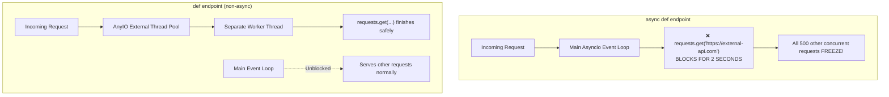

# Async & Concurrency: Event Loop Hygiene in Python APIs

In asynchronous Python frameworks (FastAPI, Starlette, Django Ninja async routes), all concurrent requests are processed on a **single-threaded cooperative event loop** (`asyncio`). A single un-awaited blocking call blocks all other concurrent users from receiving responses.

---

## 1. The Catastrophic "Blocking in `async def`" Trap

FastAPI handles `def` and `async def` routes fundamentally differently:



### The Golden Rule of Route Handlers:
1. **If using native async I/O (`httpx.AsyncClient`, `asyncpg`, `aioredis`)**: Define endpoint with **`async def`**.
2. **If using synchronous blocking I/O (`requests`, synchronous `boto3`, standard `psycopg2`)**: Define endpoint with standard **`def`**! FastAPI will automatically offload the call to an AnyIO thread pool so it does not freeze the main event loop.
3. **If inside an `async def` function and must execute blocking code**: Explicitly wrap the call using **`asyncio.to_thread()`**:

```python
import asyncio
import time
import requests

# ❌ CATASTROPHIC: Freezes all requests on the server
@app.get("/bad")
async def bad_route():
    time.sleep(2)  # Blocks event loop!
    response = requests.get("https://api.github.com")  # Blocks event loop!
    return response.json()

# ✅ SAFE (Option 1): Let FastAPI run it in a threadpool
@app.get("/safe-sync")
def safe_sync_route():
    time.sleep(2)  # Runs in background thread; event loop stays unblocked
    response = requests.get("https://api.github.com")
    return response.json()

# ✅ SAFE (Option 2): Explicit offloading via asyncio.to_thread
@app.get("/safe-async-offload")
async def safe_offload_route():
    # Offload sync blocking work to default executor thread pool
    data = await asyncio.to_thread(requests.get, "https://api.github.com")
    return data.json()

# ✅ BEST: Use native non-blocking async client
import httpx

@app.get("/best-async")
async def best_async_route():
    async with httpx.AsyncClient() as client:
        response = await client.get("https://api.github.com")
        return response.json()
```

---

## 2. Django Async Views & Async ORM (`a-` methods)

Since Django 4.1+, the Django ORM supports asynchronous database queries. However, Django views running on ASGI must use the explicit async ORM methods:

```python
from django.http import JsonResponse
from .models import Article

# Async view on ASGI (Uvicorn / Daphne)
async def latest_articles(request):
    # Use 'a-' prefixed methods for async ORM access:
    article = await Article.objects.filter(status="published").afirst()
    if not article:
        return JsonResponse({"error": "No articles found"}, status=404)
        
    # Asynchronously iterate over querysets:
    results = []
    async for item in Article.objects.filter(author=article.author).order_by("-created_at")[:5]:
        results.append({"title": item.title, "slug": item.slug})
        
    return JsonResponse({"latest": article.title, "related": results})
```

> [!WARNING]
> **Synchronous ORM Call in Async View**: Calling standard sync ORM methods like `Article.objects.get(id=1)` inside an `async def` view will raise a `SynchronousOnlyOperation` exception to protect the event loop. Always use `aget()` or wrap with `asgiref.sync.sync_to_async`.

---

## 3. Worker Concurrency & Multi-Process Scaling

In production, neither FastAPI nor Django should run on a single Python process. Python's Global Interpreter Lock (GIL) limits CPU utilization to one core per process:

```bash
# Production FastAPI (Gunicorn process manager + Uvicorn worker class)
gunicorn src.main:app \
  --workers 4 \
  --worker-class uvicorn.workers.UvicornWorker \
  --bind 0.0.0.0:8000 \
  --timeout 60 \
  --keep-alive 5
```

- **Worker Calculation**: Sizing formula: `workers = (2 * CPU_CORES) + 1`
- **Memory Footprint**: Each worker process occupies independent memory; size Docker container RAM accordingly.
