# FastAPI vs. Django: Architectural Trade-Offs & Decision Guide

Choosing between **FastAPI** and **Django** (alongside Django REST Framework / Django Ninja) is one of the most critical decisions in modern Python backend engineering. Neither is universally superior; each solves distinct engineering requirements.

---

## 1. Quick Decision Matrix: When to Use Which

| Architectural Dimension | Choose **FastAPI** | Choose **Django / Django Ninja** |
|---|---|---|
| **Core Philosophy** | Lightweight, high-performance, async-native micro-framework. | "Batteries-included" full-stack enterprise web framework. |
| **Data & ORM Needs** | Polyglot persistence, external microservices, NoSQL (MongoDB), or flexible async ORMs (SQLAlchemy 2.0, SQLModel, Tortoise). | Complex relational schema (PostgreSQL, MySQL) where built-in Django ORM, auto-migrations, and admin panel provide massive velocity. |
| **Admin Dashboard** | Not built-in. (Must build custom or use third-party tools like SQLAdmin / Retool). | **Native Django Admin**: Instant production-ready CRUD dashboard with RBAC and audit logging out of the box. |
| **Concurrency & I/O** | High-concurrency I/O (WebSockets, SSE, async streaming, real-time AI/LLM streaming). | Standard synchronous or hybrid CRUD, content management, ERP, enterprise SaaS. |
| **Data Validation** | **Pydantic v2**: Lightning-fast C/Rust-powered validation, OpenAPI 3.1 schema auto-generation. | Django Forms / DRF Serializers (legacy) or **Django Ninja** (modern Pydantic integration). |
| **Authentication & RBAC** | Lightweight custom dependency injection (`Depends(get_current_user)` + JWT). | Built-in enterprise authentication, user management, group permissions, sessions, and CSRF protection. |
| **Project Lifespan** | Microservices, API gateways, ML/AI inference backends, greenfield real-time systems. | Multi-model monoliths, content platforms, back-office administration, B2B SaaS portals. |

---

## 2. In-Depth Comparison

### FastAPI: The Async-First Microservice Engine
- **Strengths**:
  - **Native Async & Performance**: Built on Starlette and Pydantic. Handles tens of thousands of concurrent connections on ASGI (Uvicorn).
  - **First-Class OpenAPI / Swagger**: OpenAPI 3.1 documentation (`/docs`, `/redoc`) generated automatically from type hints.
  - **Compositional Dependency Injection**: Clean, testable `Depends()` system allowing modular request scoped dependencies (db sessions, auth, current tenant).
  - **Ideal for AI / LLM Streaming**: Native `StreamingResponse` for Server-Sent Events (SSE) and token-by-token LLM output.
- **Weaknesses**:
  - No built-in database layer, migrations, or admin panel. You must curate and configure your own stack (Alembic + SQLAlchemy + Pydantic-Settings + Redis).
  - Risk of architecture fragmentation if the team lacks discipline around folder structure.

### Django / Django REST Framework / Django Ninja: The Enterprise Monolith
- **Strengths**:
  - **Maximum Initial & Long-Term Velocity**: Built-in ORM with declarative schema migrations, connection pooling, and cross-table joins.
  - **The Django Admin**: Saves hundreds of hours of frontend development for internal operations, support, and business dashboards.
  - **Built-in Security Defaults**: CSRF, Clickjacking, SQL injection prevention, password hashing, and session management pre-configured securely.
  - **Django Ninja Option**: Combines Django's ORM and Admin with FastAPI-style Pydantic schemas and auto-generated Swagger documentation.
- **Weaknesses**:
  - Heavier startup footprint; historically WSGI synchronous. While modern Django supports async views and ORM queries, it is not 100% async-native across all third-party middleware and signals.
  - DRF serializers are slower than Pydantic v2 and involve significant boilerplate.

---

## 3. Architecture Comparison: Request Flow

```mermaid
flowchart TD
    subgraph FastAPI_Stack["FastAPI Architecture (ASGI)"]
        Uvicorn[Uvicorn ASGI Server] --> Starlette[Routing & Middleware]
        Starlette --> PydanticVal[Pydantic v2 Request Validation]
        PydanticVal --> DepInject["Depends() - DB Session & Auth"]
        DepInject --> AsyncEndpoint[Async Route Handler]
        AsyncEndpoint --> AsyncSQLA[SQLAlchemy 2.0 AsyncSession]
        AsyncSQLA --> AsyncDB[(PostgreSQL)]
    end

    subgraph Django_Stack["Django / DRF / Ninja Architecture"]
        Gunicorn[Gunicorn / WSGI / ASGI] --> DjMiddleware[Security & Session Middleware]
        DjMiddleware --> URLConf[urls.py Routing]
        URLConf --> ViewSet[ViewSet / Ninja Router]
        ViewSet --> Serializer[Serializer / Schema Validation]
        Serializer --> ServiceLayer[Service / Business Layer]
        ServiceLayer --> DjORM[Django ORM QuerySet]
        DjORM --> SyncDB[(PostgreSQL)]
    end
```

