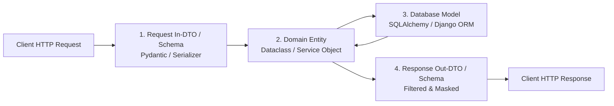
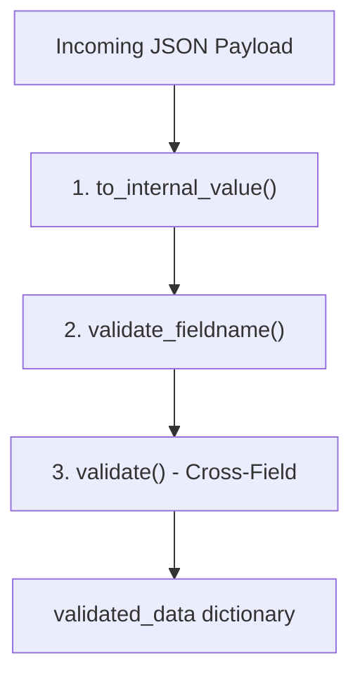

# Data Modeling, Validation & Schemas: FastAPI & Django

Request and response validation is the first line of defense for any API. It prevents corrupted data from entering the domain layer, guards against malformed inputs and injection vectors, and generates strict, auto-documenting OpenAPI specifications.

---

## 1. The 4-Tier Data Boundary Separation

A primary architectural anti-pattern in both FastAPI and Django is exposing database ORM models directly to the HTTP layer. Always separate data representation into 4 explicit tiers:



- **Tier 1 (Request DTO)**: Accepts only permitted input fields. Strictly validates formats, ranges, and invariants.
- **Tier 2 (Domain Entity / Service DTO)**: Pure Python business object (e.g. `@dataclass(slots=True)`), free from web framework dependencies.
- **Tier 3 (Database ORM Model)**: Represents storage schema, foreign keys, and indexes. Never leaked to clients.
- **Tier 4 (Response DTO)**: Strips sensitive fields (passwords, salts, internal IDs, soft-delete flags) and shapes data specifically for the consumer.

---

## 2. Pydantic v2 Mastery (FastAPI & Django Ninja)

Pydantic v2 is powered by `pydantic-core` (written in Rust), offering $5\text{--}15\times$ faster validation than v1.

### 1. Granular Field Constraints with `Annotated`
Prefer modern `typing.Annotated` with `Field` over legacy default parameters for cleaner, reusable constraints:

```python
from typing import Annotated
from pydantic import BaseModel, Field, EmailStr, HttpUrl

Username = Annotated[
    str, 
    Field(min_length=3, max_length=30, pattern=r"^[a-zA-Z0-9_-]+$", description="Alphanumeric username")
]
PriceCents = Annotated[int, Field(ge=0, description="Price in positive integer cents to avoid floating-point errors")]

class ProductCreate(BaseModel):
    title: Annotated[str, Field(min_length=1, max_length=150)]
    sku: Annotated[str, Field(pattern=r"^[A-Z]{3}-\d{5}$")]
    price_cents: PriceCents
    contact_email: EmailStr
    website: HttpUrl | None = None
```

### 2. Field Validators (`@field_validator`)
Use `@field_validator` for single-field transformations and domain sanitization:

```python
from pydantic import BaseModel, field_validator

class UserRegistration(BaseModel):
    email: str
    phone: str

    @field_validator("email", mode="before")
    @classmethod
    def normalize_email(cls, v: str) -> str:
        """Sanitizes email before validation runs: trim whitespace and lowercase."""
        if isinstance(v, str):
            return v.strip().lower()
        return v

    @field_validator("phone")
    @classmethod
    def validate_e164_phone(cls, v: str) -> str:
        clean_phone = "".join(c for c in v if c.isdigit() or c == "+")
        if not clean_phone.startswith("+") or len(clean_phone) < 10:
            raise ValueError("Phone must be in international E.164 format (e.g. +14155552671)")
        return clean_phone
```

- **`mode="before"`**: Runs before Pydantic parses types. Perfect for trimming strings, parsing custom date strings, or coercing input formats.
- **`mode="after"` (default)**: Runs after type parsing. Receives already-validated types.

### 3. Cross-Field Model Validators (`@model_validator`)
Use `@model_validator` when validation depends on multiple fields simultaneously (e.g., date ranges, password confirmation):

```python
from pydantic import BaseModel, model_validator
from datetime import date

class BookingRequest(BaseModel):
    check_in: date
    check_out: date
    promo_code: str | None = None
    discount_rate: float = 0.0

    @model_validator(mode="after")
    def validate_dates_and_promos(self) -> "BookingRequest":
        if self.check_out <= self.check_in:
            raise ValueError("check_out date must be strictly after check_in date")
        
        if self.discount_rate > 0 and not self.promo_code:
            raise ValueError("discount_rate requires a valid promo_code")
            
        return self
```

### 4. Computed Fields (`@computed_field`)
Calculate derived fields dynamically for response schemas without saving redundant data in the database:

```python
from pydantic import BaseModel, computed_field

class OrderResponse(BaseModel):
    id: int
    subtotal_cents: int
    tax_cents: int
    shipping_cents: int

    @computed_field
    @property
    def total_cents(self) -> int:
        return self.subtotal_cents + self.tax_cents + self.shipping_cents

    @computed_field
    @property
    def total_dollars(self) -> float:
        return round(self.total_cents / 100.0, 2)
```

### 5. ORM Integration & Serialization (`from_attributes`)
To serialize SQLAlchemy or Tortoise models into Pydantic response models, set `from_attributes = True` in `model_config`:

```python
from pydantic import BaseModel, ConfigDict
from datetime import datetime

class CustomerOut(BaseModel):
    id: int
    email: str
    created_at: datetime

    # Enables automatic mapping from SQLAlchemy/Django ORM instances: CustomerOut.model_validate(db_customer)
    model_config = ConfigDict(from_attributes=True)
```

---

## 3. Polymorphic Payloads via Discriminated Unions

When an endpoint accepts multiple variations of a message or payment type, use **Discriminated Unions** instead of loose dictionaries or optional fields:

```python
from typing import Literal, Annotated, Union
from pydantic import BaseModel, Field

class CreditCardPayment(BaseModel):
    method: Literal["credit_card"]
    card_token: str
    cvv: str

class CryptoPayment(BaseModel):
    method: Literal["crypto"]
    wallet_address: str
    network: Literal["ethereum", "bitcoin", "solana"]

class BankTransferPayment(BaseModel):
    method: Literal["bank_transfer"]
    iban: str
    routing_number: str

# Discriminated Union: Pydantic inspects the 'method' field and validates the exact matching schema
PaymentMethod = Annotated[
    Union[CreditCardPayment, CryptoPayment, BankTransferPayment],
    Field(discriminator="method")
]

class CheckoutPayload(BaseModel):
    order_id: str
    payment: PaymentMethod
```

---

## 4. Django REST Framework: Serializer Validation Lifecycle

In Django REST Framework (DRF), validation occurs in a defined pipeline:



### Clean DRF Serializer Pattern
```python
from rest_framework import serializers
from django.utils import timezone
from .models import Subscription

class SubscriptionSerializer(serializers.ModelSerializer):
    tier = serializers.ChoiceField(choices=["starter", "pro", "enterprise"])
    referral_code = serializers.CharField(required=False, allow_blank=True, max_length=20)

    class Meta:
        model = Subscription
        fields = ["id", "tier", "referral_code", "starts_at", "auto_renew"]
        read_only_fields = ["id", "starts_at"]

    def validate_referral_code(self, value):
        """Single-field validation."""
        if value and not value.isalnum():
            raise serializers.ValidationError("Referral code must be alphanumeric.")
        return value.upper()

    def validate(self, attrs):
        """Cross-field validation."""
        if attrs.get("tier") == "enterprise" and not attrs.get("referral_code"):
            raise serializers.ValidationError({"referral_code": "Enterprise tier requires a valid partner referral code."})
        return attrs
```

---

## 5. Defense-in-Depth: Payload Sanitization & Abuse Prevention

### 1. JSON Payload Size Limits (Memory Bomb Defense)
Clients can submit 50 MB JSON payloads to cause high CPU parsing overhead and RAM exhaustion. Add a request size limit middleware:

```python
from fastapi import Request, HTTPException, status
from starlette.middleware.base import BaseHTTPMiddleware

class ContentLengthLimitMiddleware(BaseHTTPMiddleware):
    def __init__(self, app, max_upload_size_bytes: int = 2 * 1024 * 1024):  # 2 MB default
        super().__init__(app)
        self.max_upload_size = max_upload_size_bytes

    async def dispatch(self, request: Request, call_next):
        content_length = request.headers.get("content-length")
        if content_length and int(content_length) > self.max_upload_size:
            raise HTTPException(
                status_code=status.HTTP_413_REQUEST_ENTITY_TOO_LARGE,
                detail=f"Payload exceeds maximum allowed size of {self.max_upload_size} bytes"
            )
        return await call_next(request)
```

### 2. Strict Collection Sizing
Never accept unbounded lists of IDs or objects:
```python
from typing import Annotated
from pydantic import BaseModel, Field

class BulkTagAssignRequest(BaseModel):
    # Enforces minimum 1 and maximum 100 elements to prevent DoS via massive batch sizes
    user_ids: Annotated[list[int], Field(min_length=1, max_length=100)]
    tag: Annotated[str, Field(min_length=2, max_length=30)]
```

