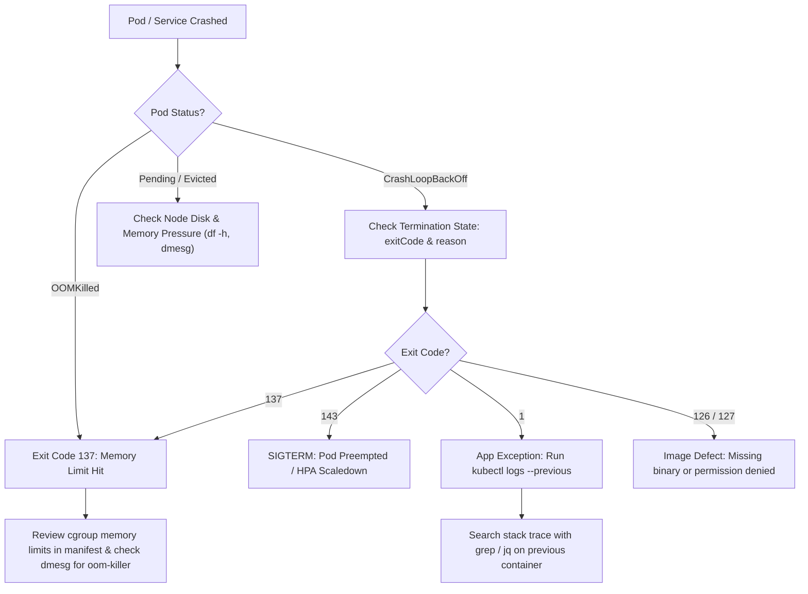

# Remote Pod Log Analyzer Reference Guide

Master operational reference for remote log analysis across Kubernetes clusters, Linux servers, and container runtimes.

---

## 1. Container Crash Diagnostic Decision Tree

When a Kubernetes container or Linux daemon crashes, follow this diagnostic path:



---

## 2. Master One-Liner Cheatsheet

### Kubernetes & Containers
```bash
# Previous container crash logs
kubectl logs <pod> -n <ns> --previous --tail=500

# Search all pods of a service for errors in last 30 minutes
kubectl logs -n prod -l app=order-api --since=30m --tail=1000 | grep -E 'ERROR|FATAL'

# Direct node pod log search without downloading
ssh user@node "zgrep -E 'Exception' /var/log/pods/prod_order-*/*/*.log" | tail -n 100

# Containerd inspect container logs on host
sudo crictl logs --tail=200 <container-id>
```

### Log Filtering & Aggregation
```bash
# Top 10 error signatures (with numbers/UUIDs stripped)
grep 'ERROR' /var/log/app.log | \
    sed -E 's/[0-9a-fA-F-]{36}/<UUID>/g; s/[0-9]+/<NUM>/g' | \
    sort | uniq -c | sort -rn | head -n 10

# Count HTTP response codes in Nginx/Apache access logs
awk '{print $9}' /var/log/nginx/access.log | sort | uniq -c | sort -rn

# Search gzipped rotated logs in-stream
zgrep -i 'deadlock' /var/log/mysql/error.log*.gz

# Parallel multi-core recursive search with ripgrep
rg -z -C 3 'panic: runtime error' /var/log/pods/
```

### JSON & Systemd
```bash
# Structured JSON logs error filtering with jq
kubectl logs <pod> | jq -r 'select(.level == "error") | [.time, .msg, .error.stack] | @tsv'

# Systemd Kubelet errors in last hour
journalctl -u kubelet --since "1 hour ago" -p err..alert --no-pager

# Kernel OOM events
dmesg -T | grep -iE 'killed process|oom-killer' | tail -n 10
```

---

## 3. High-Cardinality Scrubbing (PII & Secret Defense)

When copying logs from production to tickets or sharing in incident channels, always scrub sensitive tokens:

```bash
# Scrub Bearer tokens, passwords, and credit card numbers
kubectl logs <pod> | \
    sed -E 's/Bearer [a-zA-Z0-9._-]+/Bearer [REDACTED]/g' | \
    sed -E 's/(password|secret|token)=[^ &]+/\1=[REDACTED]/g' | \
    sed -E 's/[0-9]{4}-[0-9]{4}-[0-9]{4}-[0-9]{4}/[CARD_REDACTED]/g'
```

---

## 4. SSH Port Forwarding for Internal Telemetry

When an internal pod or node exposes Prometheus metrics, pprof endpoints, or diagnostic dashboards that are not exposed to the public internet:

```bash
# Port-forward remote internal service port through SSH bastion to localhost
ssh -L 9090:10.0.4.15:9090 -J user@bastion user@internal-gateway -N

# Kubernetes direct port-forward to pod
kubectl port-forward <pod-name> -n prod 6060:6060
# Access Go pprof locally: http://localhost:6060/debug/pprof/
```

---

## 5. Automated Log Extraction Scripts

The skill provides three production-grade extraction scripts in `scripts/`:

### A. Kubernetes Pod Log Extractor (`extract-pod-logs.sh`)
```bash
# Extract logs from pod with previous crash detection and secret scrubbing
./.github/skills/remote-pod-log-analyzer/scripts/extract-pod-logs.sh \
  -n prod -p payment-service-59bc96489-v4k8l --previous --since 30m -o ./extracted-logs
```
Outputs:
- `<ns>_<pod>_<timestamp>.log`: Full raw log stream
- `<ns>_<pod>_<timestamp>_errors.log`: Filtered error context lines with secrets redacted
- `<ns>_<pod>_<timestamp>_previous_crash.log`: Termination logs if container crashed
- `<ns>_<pod>_<timestamp>_summary.txt`: Top 10 error frequency rankings

### B. Remote Linux Host Extractor (`extract-remote-linux-logs.sh`)
```bash
# Query remote systemd service and inspect kernel OOM events over SSH
./.github/skills/remote-pod-log-analyzer/scripts/extract-remote-linux-logs.sh \
  -h 10.0.4.15 -u ubuntu -J ops@bastion.corp.net -s kubelet --since "1h" -o ./extracted-logs
```

### C. Cross-Platform PowerShell Extractor (`extract-remote-logs.ps1`)
```powershell
# Native PowerShell extraction for Windows / cross-platform environments
pwsh ./.github/skills/remote-pod-log-analyzer/scripts/extract-remote-logs.ps1 `
  -TargetType Pod -Namespace prod -LabelSelector 'app=order-api' -ExtractPrevious -Since "1h"
```

---

## 6. References & Cross-Skill Links

- [SSH Execution & Bastions](file:///.github/skills/remote-pod-log-analyzer/ssh-and-connectivity/ssh-execution-and-bastions.md)
- [Pod Log Extraction](file:///.github/skills/remote-pod-log-analyzer/kubernetes-and-containers/pod-log-extraction.md)
- [Grep & Compressed Logs](file:///.github/skills/remote-pod-log-analyzer/log-processing-toolkit/grep-ripgrep-and-compressed.md)
- [Awk Stream Parsing](file:///.github/skills/remote-pod-log-analyzer/log-processing-toolkit/awk-and-stream-parsing.md)
- [JSON & JQ Parsing](file:///.github/skills/remote-pod-log-analyzer/log-processing-toolkit/json-and-jq-parsing.md)
- [Systemd & Kernel Dmesg](file:///.github/skills/remote-pod-log-analyzer/log-processing-toolkit/systemd-and-journalctl.md)
- [Incident Triage Runbook](file:///.github/skills/remote-pod-log-analyzer/analytical-recipes/incident-triage-and-root-cause.md)
- [Troubleshoot and Fix](file:///.github/skills/troubleshoot-and-fix/SKILL.md) — Isolated testbed reproduction and remediation.
