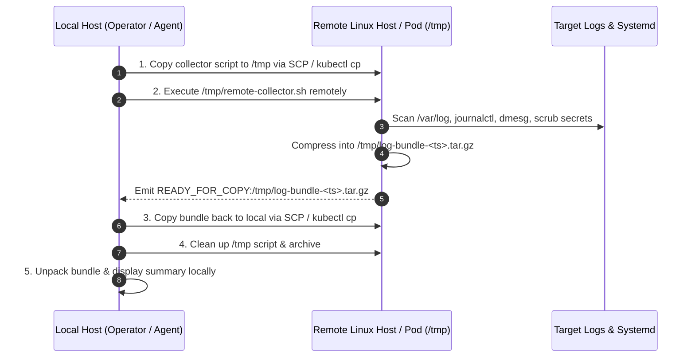

# Remote Staging, In-Situ Execution & Copy-Back Protocol

Staff-level operational guide to staging diagnostic collector scripts in remote `/tmp/`, executing in-situ, copying compressed archives back to local, and cleaning up.

---

## 1. Why In-Situ Remote Staging Matters

Streaming raw multi-gigabyte log files over SSH or WAN connections is slow, brittle, and error-prone:
- An SSH pipe break mid-transfer leaves corrupt local files.
- Searching 10 GB of logs over a network saturates ingress/egress bandwidth and causes high cloud data transfer costs.
- Searching locally consumes high local CPU and memory.

### The 4-Phase Remote Staging Protocol



---

## 2. Step-by-Step Remote Linux Host Execution (SCP + SSH)

### Phase 1: Copy to Remote `/tmp`
```bash
scp -o BatchMode=yes -o StrictHostKeyChecking=accept-new [-J bastion] \
    ./remote-collector.sh user@remote-host:/tmp/remote-collector.sh
```

### Phase 2: Execute Remotely in `/tmp`
```bash
ssh -T -o BatchMode=yes user@remote-host \
    "chmod +x /tmp/remote-collector.sh && /tmp/remote-collector.sh '1h' '/var/log/nginx/error.log' 'kubelet'"
```
The remote script:
1. Queries `journalctl` for priority errors (`err..emerg`).
2. Extracts kernel OOM-killer events from `dmesg -T`.
3. Scans target log files with `zgrep` (compressed) or `grep`.
4. Sanitizes all Bearer tokens and passwords using `sed`.
5. Packs results into `/tmp/log-bundle-<timestamp>.tar.gz`.

### Phase 3: Copy Bundle Back to Local
```bash
scp -o BatchMode=yes user@remote-host:/tmp/log-bundle-<timestamp>.tar.gz ./extracted-logs/
```

### Phase 4: Clean Up Remote Artifacts
```bash
ssh -T -o BatchMode=yes user@remote-host \
    "rm -f /tmp/remote-collector.sh /tmp/log-bundle-<timestamp>.tar.gz"
```

---

## 3. Step-by-Step Kubernetes Pod Execution (`kubectl cp` + `exec`)

### Phase 1: Copy into Pod `/tmp`
```bash
kubectl cp ./remote-collector.sh <namespace>/<pod-name>:/tmp/pod-collector.sh [-c <container>]
```

### Phase 2: Execute in Pod
```bash
kubectl exec <pod-name> -n <namespace> [-c <container>] -- \
    /bin/sh -c "chmod +x /tmp/pod-collector.sh && /tmp/pod-collector.sh '1h'"
```

### Phase 3: Copy Bundle from Pod to Local
```bash
kubectl cp <namespace>/<pod-name>:/tmp/log-bundle-<timestamp>.tar.gz \
    ./extracted-logs/pod-bundle.tar.gz [-c <container>]
```

### Phase 4: Clean Up Pod `/tmp`
```bash
kubectl exec <pod-name> -n <namespace> [-c <container>] -- \
    rm -f /tmp/pod-collector.sh /tmp/log-bundle-<timestamp>.tar.gz
```

### Phase 5: Fallback Handling
If a container image is minimal/distroless (lacking `tar` or `/bin/sh`) or has a read-only root filesystem (`readOnlyRootFilesystem: true`):
- `kubectl cp` returns a non-zero exit code.
- The automated script seamlessly falls back to streaming `kubectl logs --since=1h --timestamps` and `kubectl logs --previous`.

